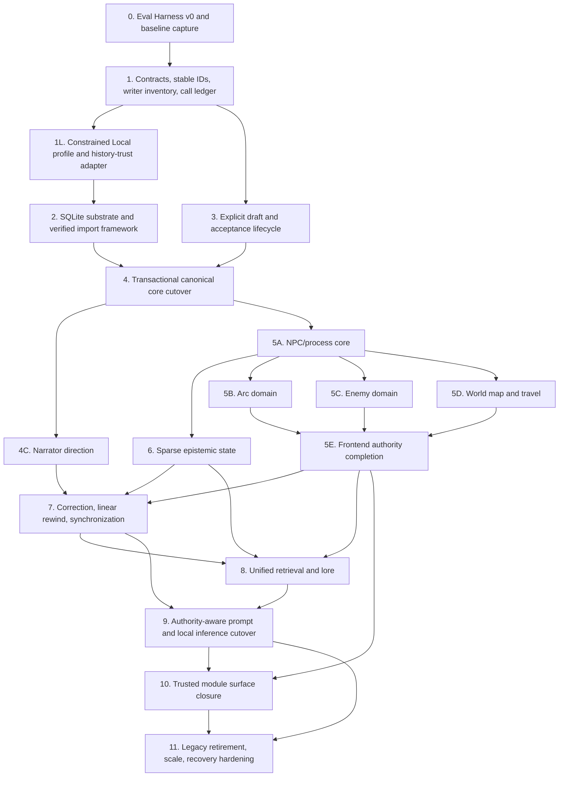

# DMNarrativeEngine-Next Implementation Roadmap

**Status:** Canonical implementation roadmap; planning only, with no implementation authorized by this document  
**Architectural contract:** [`002-target-architecture.md`](./002-target-architecture.md)  
**Migration source:** The current NarrativeEngine-P-derived runtime in this repository  
**Product baseline:** One human controller, one serialized local Story endpoint, 20B–30B quantized models, 4K–16K contexts, weak structured output, and possible CPU-only or partial GPU offload

**Review disposition:** The required material decomposition and migration-safety revisions have been incorporated. Phase 0 remains separately gated and is not authorized by this roadmap alone.

## 1. Roadmap Rules

This roadmap evolves the current application without a big-bang rewrite. Each authority transition is explicit and independently testable. Reversibility is described precisely: a true authority rollback is allowed only before the first successful write by the new owner; afterward the choices are snapshot restoration, which may discard later user work, or fix-forward repair under the current authority.

**Parity rule:** Parity is the default migration goal, but known defects or architecture violations must not be reproduced merely to achieve behavioral equivalence. Any intentional deviation must be documented and covered by a corrected invariant/evaluation. This applies specifically to legacy `knownBy`, writable Zustand mirrors, model-driven post-turn state, historical messages retaining instruction authority, and generic module tables acting as domain authority.

The following rules apply to every phase:

- A domain has exactly one authoritative writer at a time.
- A mixed-authority migration period may exist **between domains**, but the same record/domain is never permanently authoritative in both SQLite and a legacy file.
- Legacy data may be read for import, verification, fallback before cutover, or export compatibility. It is not dual-written after its domain switches authority.
- Derived retrieval and indexing may shadow-run because their results are nonauthoritative.
- The normal-turn call count never increases as a migration shortcut.
- No phase requires Story JSON, tool calling, blocking extraction, or embeddings.
- First-party world-map, enemy, arc, and related behavior stays available until typed replacements and verified importers exist.
- Every destructive retirement follows a proven replacement, a migration report, a recovery artifact, and before/after evaluation.
- Every authoritative read or write resolves through one central domain-authority router during migration. An authority mismatch is a hard failure; compatibility projections are read-only and identify their source commit/version.
- Authority ownership advances monotonically per domain: `legacy -> shadow -> sqlite -> retired`. Once the new owner has accepted an authoritative write, the domain cannot move backward to legacy authority.
- Native indexed reads, bounded working windows, pagination, incremental FTS maintenance, and avoidance of whole-array rewrites begin when each SQLite data class becomes authoritative; they are not deferred wholesale to the final performance phase.
- New executable-extension dependencies are frozen in Phase 1. Existing bundled behavior may be repaired and maintained until its typed replacement is accepted.
- Upstream implementation details inform migration mechanics but cannot override the target architecture.

### 1.1 Recovery terminology used by every phase

| Term | Exact meaning |
|---|---|
| **True rollback** | Return authority to the old owner before the first successful authoritative write by the new owner. |
| **Snapshot restoration** | Restore a verified recovery artifact to an earlier point. This can discard user work created after that point and must say so before execution. |
| **Fix-forward** | Keep the current authority owner and repair schema, data, routing, or derived artifacts while preserving later valid work. |

## A. Dependency Graph

### 2. Architectural dependency graph

### 2.1 Why this is the dependency order

1. **Evaluation precedes behavior change.** The repository already has a deterministic canonical-turn runner under [`src/services/turn/__tests__/baseAppGate`](../../src/services/turn/__tests__/baseAppGate). It must become the seed of a broader reproducible evaluation harness before continuity, persistence, retrieval, or prompt behavior changes.
2. **Stable identity and writer visibility precede persistence cutover.** SQLite cannot safely consolidate records whose identities and writers are unknown. Phase 1 supplies migration contracts and the central authority router contract, not premature concrete repositories.
3. **The target-local constraint is exercised early.** Phase 1L uses existing switches to create an opt-in transitional one-Story-call profile, records real queue/TTFT/latency behavior, and makes historical instructions inert before persistence work proceeds in earnest. It is not the final Phase 9 packer.
4. **SQLite appears before it becomes authoritative.** Schema migrations, import verification, backup, and integrity tooling must be proven on disposable converted copies while legacy files remain the sole authority.
5. **Draft identity precedes transactional acceptance.** The current [`pendingCommit.ts`](../../src/services/turn/pendingCommit.ts) and swipe lifecycle need explicit revision IDs and hashes before a selected draft can be committed atomically or bind optional proposals safely.
6. **Canonical evidence and critical tracked domains cross together.** The first authority cutover must commit the accepted revision, applicable critical state, provenance, and dirty markers as one coherent cutover—never separate evidence and state authority events.
7. **Narrator direction follows the canonical core immediately.** It needs stable campaign/turn identity but not every optional domain, so delaying it behind world-map, enemy, and arc migration creates no safety benefit.
8. **Remaining domains migrate through independent gates.** NPC/process core comes first; arc, enemy, and world-map/travel then migrate as explicit packages, followed by frontend authority completion.
9. **Epistemic state requires stable entities, evidence references, and Phase 5A NPC/core state—not every first-party module.** It may proceed in parallel with Phases 5B–5D and never falls back to `knownBy` after cutover.
10. **Correction precedes synchronization.** A detected sync issue needs a safe resolution command, dependency reporting, and targeted invalidation path. Synchronization cannot be introduced first.
11. **Retrieval follows authority, corrections, and epistemics.** Only then can direct state queries, stale-evidence suppression, and character-specific knowledge filters be correct.
12. **The final prompt packer follows retrieval cutover.** Phase 1L hardens trust narrowly, but Phase 9 alone replaces full context packing against stable read interfaces.
13. **Extension closure follows first-party migration.** Closing current mod surfaces before world map, enemies, and arcs have typed homes would remove working gameplay.
14. **Legacy retirement is last.** It removes remaining compatibility paths and measured O(N) problems; bounded native reads begin at each earlier authority switch.

### 2.2 Authority transitions by data class

| Data class | Authority before migration | Staging/shadow period | Authority switch | Legacy after switch |
|---|---|---|---|---|
| Draft/swipe metadata | Zustand/campaign message state | Explicit revision/hash model in existing persistence | Phase 3 establishes semantics; Phase 4 persists in SQLite | Import/export compatibility only after Phase 4 |
| Accepted narrative | Markdown archive plus chat state | Phase 2 verified import into disposable DB | Phase 4B2 coherent per-campaign cutover | Preserved source; generated export; no writes |
| Critical tracked state | `GameContext`, inventory/profile mirrors, location/NPC JSON | Phase 4A2 typed import/compare | Phase 4B2 with accepted narrative | Read-only migration source/export |
| NPC/process state | NPC JSON, divergence/timeline, relationship files, context fields | Phase 5A typed import/compare | Phase 5A by declared domain | Read-only compatibility |
| Arc state | Generic/mod tables | Phase 5B typed importer and behavioral parity | Phase 5B | Preserved import source, then export only |
| Enemy state | Generic/mod tables | Phase 5C typed importer and behavioral parity | Phase 5C | Preserved import source, then export only |
| World map/travel state | Generic/mod tables and context fields | Phase 5D typed importer and behavioral parity | Phase 5D | Preserved import source, then export only |
| Epistemic state | `knownBy`, witnesses, relationship memory, prose | Phase 6 conservative candidate report | Phase 6 after Phase 5A | Witness/history retained as evidence, never fallback belief authority |
| Narrative directions | Ask-GM/OOC transient paths and settings | Phase 4C import/default mapping | Phase 4C | Old OOC stores read only, then removed |
| Evidence retrieval | Archive index, IDF/RRF, vectors, chapters, overlapping middleware | Phase 8 shadow comparison | Phase 8C | Old retrievers removed; vectors rebuilt |

### 2.3 Current writer groups that must be redirected or retired

| Writer group | Current examples | Target destination |
|---|---|---|
| Whole campaign/state saves | [`campaignStore.ts`](../../src/store/campaignStore.ts), [`campaignSlice.ts`](../../src/store/slices/campaignSlice.ts), [`chatSlice.ts`](../../src/store/slices/chatSlice.ts) | Query cache plus typed commands/repositories |
| Archive acceptance | [`pendingCommit.ts`](../../src/services/turn/pendingCommit.ts), [`postTurnPipeline.ts`](../../src/services/turn/postTurnPipeline.ts), [`archiveService.js`](../../server/services/archiveService.js) | Transactional acceptance service |
| Direct context mutations | [`turnStages.ts`](../../src/services/turn/turnStages.ts), post-turn tracks, tool handlers | Validated domain commands |
| NPC and relationship writers | NPC tracks, [`agency`](../../src/services/npc/agency), relationship memory/updaters | Typed NPC/goal/relationship/epistemic commands |
| Timeline/divergence/facts writers | [`campaign-state`](../../src/services/campaign-state), server facts/timeline/divergence routes | Domain repositories plus canonical evidence links |
| Generic/mod-table writes | [`modTables.ts`](../../src/services/mods/modTables.ts), [`tableRegistry.js`](../../server/lib/tableRegistry.js), first-party manifests | Typed first-party module repositories |
| Model-driven post-turn writers | inventory/profile/location/event/witness/relationship tracks, server NLP pipeline | Deterministic effects, optional proposals, or derived suggestions |

## B. Phase Overview

### 3. Phase table

| Phase | Objective | Prerequisite | Major architecture affected | User-visible impact | Risk | Rollback difficulty |
|---|---|---|---|---|---|---|
| 0 | Eval Harness v0 and current baseline | Architecture contract | Evaluation/observability | None | Low | Low |
| 1 | Migration contracts, stable IDs, writer inventory, call ledger, router contract | Phase 0 | Cross-cutting seams | Diagnostics only | Medium | Low |
| 1L | Transitional Constrained Local profile and history-trust adapter | Phase 1 | Existing settings/call paths/prompt history | Opt-in faster local path | Medium | Low |
| 2 | SQLite substrate, verified importer, backup, and recovery proof | Phase 1L | Persistence/migration | Explicit conversion preview/report only | High | Low while no authority switches |
| 3 | Explicit draft/revision/hash lifecycle and acceptance coordinator | Phase 1, Eval baseline | Turn/swipe/edit/canonicalization seam | Same UX with clearer recovery | High | Medium |
| 4 | Canonical schemas, critical-domain import, rehearsal, then coherent narrative/state cutover | Phases 2–3 | Persistence, mutation, turn commit | More reliable acceptance/recovery | Very high | Very high after first new-owner write |
| 4C | Narrator profiles and scoped temporary direction | Phase 4 | OOC/meta continuity | First-class trusted narrator control | Medium | Fix-forward after writes |
| 5 | 5A NPC/process core; 5B arc; 5C enemy; 5D world map/travel; 5E frontend authority completion | Phase 4 | State, NPC, modules, frontend cache | Feature parity; lighter campaign state | Very high | Per-subphase snapshot/fix-forward |
| 6 | Sparse epistemic state | Phase 5A | Knowledge and prompt inputs | Character-specific continuity controls | High | Snapshot/fix-forward; no `knownBy` fallback |
| 7 | Corrections and linear rewind first, then four-category synchronization | Phase 4C, Phase 5E, Phase 6 | Corrections/provenance/state sync | Simplified correction UI; unobtrusive sync issues | Very high | Snapshot or compensating correction |
| 8 | Shadow then cut over unified retrieval and stable-ID lore | Phases 5–7 | Retrieval/lore/context | More predictable recall | High | Medium |
| 9 | Authority-aware output-first prompt and one-call local-profile cutover | Phase 8 | Prompt/inference/background scheduling | Lower latency and fewer stalls | Very high | Medium |
| 10 | Close public executable extension surfaces | Phase 5E, 9A | Modules/mods | External executable mods stop being supported | Very high | Medium |
| 11 | Retire legacy stores; scale and recovery hardening | All authority cutovers | Persistence/operations | Faster large campaigns, final backup/export | High | High |

### 3.1 Playable milestones

| Milestone | Reached after | Playability claim |
|---|---|---|
| M0 — Reproducible current baseline | Phase 0 | Current behavior is measured and replayable |
| M1 — Contracts and constrained-local proof | Phase 1L | Existing runtime remains authoritative; opt-in one-Story behavior and historical trust are measured |
| M2 — Migration scaffolding | Phase 2B | Existing runtime remains authoritative; conversion previews are safe |
| M3 — Explicit draft lifecycle | Phase 3B | Existing campaigns play normally with recoverable draft acceptance |
| M4 — Transactional canonical core | Phase 4B2 | New accepted turns and critical tracked changes are atomic in SQLite |
| M5 — Typed deterministic world | Phase 5E | NPC/process/module writes use typed commands; Zustand is no longer authority |
| M6 — Continuity control | Phase 7B | Corrections, rewind, epistemics, and sync issues use canonical provenance |
| M7 — Unified local Story path | Phase 9B | One required Story call, bounded prompt, simplified retrieval, safe background policy |
| M8 — Target authority model complete | Phase 11 | Legacy files are import/export compatibility only |

## Phase 0 — Eval Harness v0 and Baseline Capture

### Goal

Create the smallest reproducible evaluation baseline before changing major continuity behavior.

### Why this phase occurs at this point

The current runtime has thousands of tests, but ordinary unit coverage cannot compare retrieval, prompts, effects, call counts, and long-turn behavior across architecture versions. The existing base-app canonical runner is a strong seed and should be generalized before any authority migration.

### Current architecture being changed

- [`src/services/turn/__tests__/baseAppGate/runCanonicalTurn.ts`](../../src/services/turn/__tests__/baseAppGate/runCanonicalTurn.ts) already runs the real turn and pending commit through deterministic seams.
- [`recorder.ts`](../../src/services/turn/__tests__/baseAppGate/recorder.ts) records payloads, callbacks, API effects, queues, and final messages.
- [`turnContextGolden.test.ts`](../../src/services/turn/__tests__/turnContextGolden.test.ts) freezes a complete prompt payload.
- Vitest configuration lives in [`vitest.config.ts`](../../vitest.config.ts).

### Target state after the phase

`Eval Harness v0` can run a small fixture suite against the current engine, save a versioned result artifact, and compare later versions without live model sampling. A separate small live target-local-model smoke establishes real latency and prose observations without becoming a routine nondeterministic gate.

### Exact scope

- Extract reusable fixture/replay/metric seams from the existing base-app gate without changing production behavior.
- Add three to five controlled scenarios: canonical turn/commit, stale fact supersession, character-secret filtering, correction retention, and local-call counting.
- Record prompt messages/trace, retrieval IDs, state/effect writes, model-call labels, and token estimates where already available.
- Make deterministic artifacts exclude wall-clock timestamps, machine paths/identifiers, random run IDs, and machine-dependent timing values. Store performance samples in a separate explicitly non-deterministic artifact.
- Label captured expectations as either **nonnormative behavioral snapshots** (what the current runtime did) or **normative assertions** (what the architecture requires). A snapshot mismatch requests review; only a violated normative assertion is inherently a failure.
- Define a machine-readable result schema and human diff summary.
- Run a fixed 5–10-turn live smoke against the selected target local model and named hardware/offload configuration. Capture queue wait, TTFT, total latency, unexpected model calls, failures, and concise human qualitative prose notes; do not use an LLM judge.
- Capture the current repository baseline before Phase 1.

### Explicit non-scope

- No long live-model campaign runner; the only live work is the bounded 5–10-turn smoke.
- No LLM-as-judge.
- No new persistence or state model.
- No attempt to bless current behavior as correct; baseline records behavior and explicit assertions distinguish desired invariants from snapshots.

### Expected files/modules affected

- Existing: [`baseAppGate`](../../src/services/turn/__tests__/baseAppGate), [`turnContextGolden.test.ts`](../../src/services/turn/__tests__/turnContextGolden.test.ts), [`llmRequestQueue.ts`](../../src/services/llm/llmRequestQueue.ts), [`traceCollector.ts`](../../src/services/payload/traceCollector.ts).
- Likely new: `src/eval/fixtures/`, `src/eval/replay/`, `src/eval/metrics/`, `src/eval/__tests__/`, `scripts/run-eval.mjs`, and a checked-in baseline manifest.

### New schemas/interfaces/services

- `EvalScenario`, `RecordedStoryResponse`, `EvalRunManifest`, `TurnEvalResult`, `EngineEffect`, and `MetricSample`.
- A deterministic `StoryTransport` seam that can replay recorded streaming chunks without changing the production provider API.
- `SnapshotExpectationKind = 'behavioral' | 'normative'` and a separate `LiveSmokeResult`/environment manifest.

### Legacy behavior retained temporarily

All runtime behavior, payload composition, persistence, mods, and call patterns remain unchanged.

### Legacy behavior removed

None.

### Data migration requirements

None. Eval artifacts contain synthetic or explicitly scrubbed fixture data, never live campaign secrets.

### Backward compatibility requirements

The existing `test:base-app-gate` result remains green and its baseline is either preserved or deliberately versioned with an explained diff.

### Evaluation/tests required before implementation

- Full current Vitest suite green.
- Existing base-app gate and prompt golden green.
- Scenario/result schema reviewed for deterministic serialization.
- The live-smoke script, fixed turn inputs, target model identity, hardware, and offload mode are recorded before sampling.

### Acceptance criteria

- One command runs Eval Harness v0 without a live model or network.
- Re-running the same commit produces byte-stable deterministic results with no timestamps or machine-dependent values in the deterministic artifact.
- A deliberate prompt, retrieval-ID, call-count, or state-effect change produces a focused diff.
- The baseline includes at least one assertion for state, stale suppression, knowledge visibility, correction, prompt, and model-call count.
- Behavioral snapshots and normative assertions are visibly distinct in output and review policy.
- The 5–10-turn live smoke records queue wait, TTFT, total latency, call count/unexpected calls, failures, and human prose observations without an automated judge.
- Current results are checked in or otherwise version-pinned before Phase 1 begins.

### Failure/rollback strategy

The harness is additive. If extraction destabilizes the base-app gate, revert to the existing gate and introduce adapters around it rather than modifying its production seams.

### Dependencies introduced for later phases

Every later phase receives a before/after comparison gate and a place to add domain-specific scenarios. The same small live smoke repeats at major playable behavior-changing milestones: Phase 1L, Phase 4B2, Phase 4C, any Phase 5A–5D package whose cutover changes Story-visible behavior, Phase 5E, Phase 6, Phase 7B, Phase 8C, and Phase 9B. Deterministic replay remains the routine regression gate; the live smoke is not run after every commit.

## Phase 1 — Architecture Contracts, Stable IDs, Writer Inventory, and Call Ledger

### Goal

Establish nonauthoritative contracts that make ownership, identity, writes, prompt trust, and model calls visible before any storage authority moves.

### Why this phase occurs at this point

Migration cannot be safe while writes are implicit callbacks and debounced whole-store saves. This phase describes and observes current behavior first; it does not create a second store.

### Current architecture being changed

- Shared types are spread across [`src/types`](../../src/types) and [`packages/engine/src`](../../packages/engine/src).
- Writes originate through store actions in [`campaignSlice.ts`](../../src/store/slices/campaignSlice.ts), [`chatSlice.ts`](../../src/store/slices/chatSlice.ts), [`turnStages.ts`](../../src/services/turn/turnStages.ts), tracks, tools, and mod host APIs.
- Model calls are routed through [`llmService.ts`](../../src/services/llm/llmService.ts), [`llmRequestQueue.ts`](../../src/services/llm/llmRequestQueue.ts), and host-facade roles.

### Target state after the phase

Stable identifier rules, authority/trust enums, mutation-command envelopes, provenance, a central authority-router contract, model-call classifications, and a complete writer registry exist while legacy writers remain authoritative. Concrete persistence repositories are deliberately deferred.

### Exact scope

- Define stable IDs for campaign, entity, turn, revision, draft, scene/session annotation, evidence, and command/change-set references.
- Inventory every current writer by domain, trigger, origin, target file/table, and whether it is deterministic or model-derived.
- Define `MutationCommand` and origin/provenance types without redirecting all writers yet. Each new command carries expected authority owner, campaign format epoch, expected record/head version, and an idempotency key.
- Define authority-labelled `ContextRecord` and `ModelCallPurpose` contracts.
- Define one central `DomainAuthorityRouter` contract through which every authoritative read/write must resolve during migration. Mismatches fail closed; read-only compatibility projections cite the source commit/version they project.
- Define and persist the monotonic transition vocabulary `legacy -> shadow -> sqlite -> retired`; prohibit moving a domain backward after its first new-owner authoritative write.
- Extend the call ledger to classify foreground Story, foreground auxiliary, automatic background, manual utility, media, and embedding calls.
- Add a baseline-local policy in diagnostics/eval that reports violations; it does not silently change normal user settings yet.
- Freeze new dependencies on public executable extension capabilities. Existing bundled features can receive fixes, but new target work cannot add prompt interceptors, provider leases, arbitrary authority tables, or other capabilities scheduled for Phase 10 removal.

### Explicit non-scope

- No SQLite authority.
- No concrete domain repository or final SQLite domain-schema design.
- No universal generic state schema.
- No mass writer redirection.
- No removal of current model calls, mods, or store fields.

### Expected files/modules affected

- [`packages/engine/src`](../../packages/engine/src) for platform-pure contracts.
- [`src/types`](../../src/types), [`hostFacade.ts`](../../src/services/turn/hostFacade.ts), [`llmRequestQueue.ts`](../../src/services/llm/llmRequestQueue.ts), [`utilityCallTracker.ts`](../../src/services/llm/utilityCallTracker.ts).
- Writer inventory references [`campaignSlice.ts`](../../src/store/slices/campaignSlice.ts), [`postTurnPipeline.ts`](../../src/services/turn/postTurnPipeline.ts), [`tracks`](../../src/services/turn/tracks), and [`modTables.ts`](../../src/services/mods/modTables.ts).

### New schemas/interfaces/services

- `StableId`, `AuthorityClass`, `TrustClass`, `MutationOrigin`, `MutationCommand`, `CommandProvenance`, `ExpectedAuthorityOwner`, `CampaignFormatEpoch`, `ExpectedVersion`, `IdempotencyKey`, `DomainAuthority`, `AuthorityTransitionState`, `ContextRecord`, `ModelCallPurpose`.
- `DomainWriterRegistry` used for tests/diagnostics, not runtime plugin registration.
- `DomainAuthorityRouter` is an interface/contract plus contract tests only; concrete adapters arrive with the domains they route.

### Legacy behavior retained temporarily

All legacy callbacks, files, tables, prompt contributions, and model-call settings remain operational.

### Legacy behavior removed

Unclassified model calls, undocumented authoritative writers, and new dependencies on doomed executable-extension capabilities are no longer allowed in new code; existing ones are explicitly registered as migration debt.

### Data migration requirements

None. A stable-ID compatibility function may derive repeatable IDs for legacy records without writing them back yet.

### Backward compatibility requirements

Existing IDs remain resolvable through aliases/mappings. No user-visible rename or campaign rewrite occurs.

### Evaluation/tests required before implementation

- Eval v0 baseline captured.
- Boundary-gate tests for `packages/engine` purity.
- Golden tests for current host-facade and call-ledger classification.

### Acceptance criteria

- Every current authoritative writer is present in the inventory with a target retirement/redirection phase.
- Every model call in a canonical eval turn has a classified purpose and blocking/background designation.
- Stable ID generation is deterministic and collision-tested.
- New typed command APIs cannot compile without origin/provenance, expected owner, format epoch, expected version, and idempotency key. Legacy paths are inventoried and adapted incrementally rather than being forced through an unsafe mass rewrite.
- Router contract tests reject authority mismatches, reject reverse transitions after new-owner writes, and require source commit/version on compatibility projections.
- Static checks prevent new code from depending on extension capabilities scheduled for removal.
- Production behavior and model-call count are unchanged.

### Failure/rollback strategy

Contracts are additive. Revert call-ledger wrappers if provider behavior changes; retain the writer inventory and tests.

### Dependencies introduced for later phases

SQLite schemas, import maps, draft hashes, change sets, authority-aware prompts, and phase-specific writer redirection all depend on these contracts.

## Phase 1L — Transitional Constrained Local Profile and Historical-Instruction Trust Hardening

### Goal

Exercise the target hardware constraint early using existing runtime switches, and make historical instruction-shaped text inert through a narrow adapter that the final Phase 9 packer can reuse.

### Why this phase occurs at this point

Waiting until Phase 9 to discover that auxiliary calls, queue contention, or historical-role handling dominate local play would make every intervening migration harder to evaluate. Phase 1 supplies the call ledger and trust vocabulary needed to measure a safe transitional profile without designing the final prompt system.

### Current architecture being changed

- Director, planner, recommender, relationship stance, rerank/query expansion, tool/role, post-turn, enemy-discovery, and profile-update paths can consume the same serialized endpoint through [`contextGatherer.ts`](../../src/services/turn/contextGatherer.ts), [`turnStages.ts`](../../src/services/turn/turnStages.ts), and [`llmRequestQueue.ts`](../../src/services/llm/llmRequestQueue.ts).
- Historical messages can retain active role semantics in current payload construction under [`src/services/payload`](../../src/services/payload).
- Existing settings contain many of the required off switches, but they do not yet form one stable opt-in profile with a ledger-backed guarantee.

### Target state after the phase

An opt-in **Constrained Local** transitional preset keeps one foreground Story call, manual utility/media operations, and optional nonblocking embeddings while safely disabling automatic auxiliary inference where existing switches permit. A narrow evidence renderer gives active instruction authority only to the current action, active trusted OOC/direction, and application/story rules; historical text is quoted evidence. The preset has a stable identity that later migrates into Phase 9 `LocalCapabilityProfile`.

### Exact scope

- Compose existing safe switches into a new opt-in preset; never overwrite or silently reinterpret a user's current settings.
- Disable Director, planner, recommender, relationship stance, model reranking/query expansion, automatic model post-turn work, model-driven enemy discovery, profile updates, and other automatic auxiliary inference where the current runtime can do so without removing required deterministic behavior.
- Keep exactly one required Story request on the normal path. Keep explicit manual utility, media generation, and optional embeddings, with embeddings nonblocking and never required for correctness.
- Add a stable profile identifier and a migration note mapping it to the final Phase 9 capability profile.
- Add the narrow historical-evidence renderer/adapter. Only current action, active trusted OOC/direction, and application/story rules are active instructions; prior user/assistant/OOC-like content is delimited and labelled as evidence.
- Use the Phase 1 call ledger to prove the absence of unexpected auxiliary inference and record queue wait, TTFT, total latency, call count, and endpoint occupancy.
- Repeat the Phase 0 fixed 5–10-turn live smoke on the named target local model/hardware and compare it with the original baseline.

### Explicit non-scope

- No final context packer, token allocation algorithm, output-reserve policy, or retrieval redesign.
- No claim that existing queue priority can preempt a running request.
- No removal of capable-profile features, manual utilities, media, or optional embeddings.
- No user-setting rewrite and no production-default change until the opt-in profile is evaluated.

### Expected files/modules affected

- Existing settings/preset UI and types; [`contextGatherer.ts`](../../src/services/turn/contextGatherer.ts), [`turnStages.ts`](../../src/services/turn/turnStages.ts), [`llmRequestQueue.ts`](../../src/services/llm/llmRequestQueue.ts), and call-ledger instrumentation.
- A small payload/history adapter under [`src/services/payload`](../../src/services/payload) designed for reuse by Phase 9.
- Eval fixtures and live-smoke manifests from Phase 0.

### New schemas/interfaces/services

- `TransitionalLocalProfileId`, `ConstrainedLocalPreset`, `HistoricalEvidenceRenderer`, and ledger policy assertions.

### Legacy behavior retained temporarily

The current prompt builder, retrieval stack, provider support, manual utilities, media, optional embeddings, and all non-opted-in user profiles remain available.

### Legacy behavior removed

For this opt-in profile only, historical messages no longer regain active instruction authority, and safely switchable automatic auxiliary model work leaves the normal turn path.

### Data migration requirements

None. The profile is additive and stores a stable identity; existing settings remain untouched until a user opts in.

### Backward compatibility requirements

Turning the transitional profile off restores the prior settings selection without changing campaign data. The stable identity has a documented one-way mapping to the Phase 9 profile schema.

### Evaluation/tests required before implementation

- Switch-coverage tests for each disabled auxiliary path.
- Historical instruction-injection fixtures covering prior player text, assistant text, imported OOC-like content, quotations, and the active current action.
- Call-ledger assertions for one required Story call and no unexpected automatic auxiliary inference.
- The fixed Phase 0 5–10-turn live smoke measuring queue wait, TTFT, total latency, call count, endpoint occupancy, failures, and human prose observations.

### Acceptance criteria

- Opting in changes no campaign authority and overwrites no pre-existing settings.
- A normal turn makes one required Story request; any allowed manual/media/embedding call is distinctly classified and cannot block Story.
- Every disabled auxiliary path is both switch-tested and ledger-observable.
- Historical instruction-shaped text is inert quoted evidence while the current action and active trusted direction remain authoritative.
- The smoke report identifies the exact target model, hardware/offload environment, measurements, and any qualitative prose regression without an LLM judge.

### Failure/rollback strategy

This is a configuration/adapter change with no authority migration. Disable the opt-in preset and renderer adapter, retain the measurement artifacts, and fix forward before making it a recommended profile.

### Dependencies introduced for later phases

Phase 9 reuses the stable profile identity, trust tests, historical-evidence renderer, call-ledger gates, and measured local constraints; it replaces the transitional preset with the final authority-aware packer rather than treating this phase as permanent architecture.

## Phase 2 — SQLite Substrate and Verified Import Framework

### Goal

Introduce per-campaign SQLite and migration/recovery tooling without making it live authority.

### Why this phase occurs at this point

The database must prove schema migration, conversion, integrity, backup, and rollback on disposable copies before canonical turns or tracked state depend on it.

### Current architecture being changed

- Campaign paths and roughly 21 built-in files are defined in [`fileStore.js`](../../server/lib/fileStore.js).
- Archive persistence is split between [`archiveRepository.js`](../../server/services/archiveRepository.js) and [`archiveService.js`](../../server/services/archiveService.js).
- Campaign, facts, timeline, divergence, backup, and generic table routes are separate server surfaces.
- SQLite currently exists primarily for vectors in [`vectorStore.js`](../../server/lib/vectorStore.js), not campaign authority.

### Target state after the phase

A versioned `campaign.sqlite` can be created from a quiesced, internally consistent snapshot of preserved legacy files, verified, backed up, actually restored in isolation, compared with source expectations, and discarded. The runtime still reads/writes legacy authority until a later explicit cutover.

### Exact scope

#### 2A — Substrate

- Add a campaign DB opener, migration runner, integrity checks, transaction helper, and persistence test harness without committing to final domain repositories.
- Create initial non-live tables for migration metadata, source hashes, import reports, authority map, and schema version.
- Define consistent backup/restore primitives excluding vectors.

#### 2B — Import and verification

- Acquire the import source through a documented quiesce/consistent-snapshot protocol so files cannot represent different write moments.
- Import campaign identity, chat/archive evidence, archive index metadata, NPC/location/entity identifiers, state-file inventories, facts/timeline/divergence, relationship files, and mod-table inventories into staging tables or reports—not premature final domain schemas.
- Verify source counts, hashes, referential links, ordering, and first-party table coverage.
- Record import provenance for every staged item: source path, source content hash, original key/record locator, and import-run ID.
- Classify every finding as `informational`, `warning`, or `cutover-blocking`. Any unresolved authoritative mismatch or missing critical source is cutover-blocking.
- Produce a human-readable conversion preview and machine-readable report.
- Restore the staged backup into an isolated location, open it, run integrity checks, and compare it against the manifest/source expectations rather than treating backup creation as restore proof.

### Explicit non-scope

- No runtime reads from SQLite for play.
- No writes to both SQLite and legacy sources on each turn.
- No typed-state authority or prompt changes.
- No vectors inside the authority DB.

### Expected files/modules affected

- Existing: [`server/lib/fileStore.js`](../../server/lib/fileStore.js), [`server/services/backup.js`](../../server/services/backup.js), [`server/routes/backups.js`](../../server/routes/backups.js), [`server/routes/transfer.js`](../../server/routes/transfer.js), [`server/services/archiveRepository.js`](../../server/services/archiveRepository.js).
- Likely new: `server/db/campaignDb.js`, `server/db/migrations/`, `server/repositories/`, `server/services/campaignMigration.js`, `server/routes/migrations.js`, and server tests.

### New schemas/interfaces/services

- `schema_migrations`, `migration_runs`, `migration_sources`, `migration_findings`, and `domain_authority` staging metadata; findings include explicit severity and blocking disposition.
- `CampaignDb`, `MigrationPlan`, `MigrationReport`, `SourceManifest`, `BackupManifest`.

### Legacy behavior retained temporarily

All legacy files and routes remain the only live authority. Existing backups continue to work.

### Legacy behavior removed

None from the live path. Ad hoc future schema creation outside the migration runner is prohibited.

### Data migration requirements

- Conversion always reads a quiesced, manifest-addressed source snapshot and writes a new DB.
- Failure deletes/quarantines only the incomplete new DB, never source files.
- Existing vector rows are not copied as authority; they can be rebuilt later.

### Backward compatibility requirements

Opening an old campaign without choosing conversion behaves exactly as before. Conversion preview can be rerun idempotently.

### Evaluation/tests required before implementation

- Eval v0 current baseline.
- Fixture campaigns covering empty, small, corrupted optional file, long archive, relationship files, and all current first-party mod tables.
- Backup/restore round-trip tests for current legacy behavior.

### Acceptance criteria

- SQLite first appears only as a disposable staging/conversion artifact.
- Import reports reconcile every expected legacy source by count/hash, attach source path/hash/original key/import-run provenance, and classify every discrepancy by severity.
- No later cutover can proceed with a cutover-blocking finding, including an unresolved authoritative mismatch or missing critical source.
- A failed import leaves the legacy campaign byte-identical.
- Schema migrations are forward-tested and transactionally rollback on failure.
- A staged DB plus lore/assets manifest is restored into isolation and passes both integrity checks and comparison with manifest/source expectations.
- No normal-turn code writes SQLite in this phase.

### Failure/rollback strategy

Delete/quarantine only the staging DB and continue using the untouched consistent source snapshot/legacy authority. Migration version failures and cutover-blocking findings block conversion/cutover, not legacy campaign play.

### Dependencies introduced for later phases

Phase 4 uses the proven DB/transaction/import/backup foundation; later domain phases extend its schema migrations rather than inventing new stores.

## Phase 3 — Explicit Draft, Swipe, and Acceptance Lifecycle

### Goal

Turn the implicit pending-message lifecycle into explicit draft revisions and a single acceptance coordinator while preserving swipe/edit/regenerate UX.

### Why this phase occurs at this point

The transaction layer cannot safely commit “the accepted response” until the UI and orchestrator agree on exact draft identity and content hash. This work can be proven while legacy persistence is still authoritative.

### Current architecture being changed

- [`pendingCommit.ts`](../../src/services/turn/pendingCommit.ts) freezes messages and `TurnContext`, then runs the post-turn pipeline on a later send/campaign switch.
- [`swipeGeneration.ts`](../../src/services/turn/swipeGeneration.ts), message edit hooks, and chat slice fields carry swipe variants.
- [`turnStages.ts`](../../src/services/turn/turnStages.ts) marks the last assistant message `pendingCommit`.
- [`postTurnPipeline.ts`](../../src/services/turn/postTurnPipeline.ts) performs archive and bookkeeping work after acceptance.

### Target state after the phase

Each generated variant is an explicit immutable draft revision with ID/hash. Selection, editing, regeneration, acceptance, and recovery are state-machine transitions coordinated through one service. Legacy archive/state writers still execute behind that coordinator.

### Exact scope

#### 3A — Draft identity

- Define draft set, draft revision, source player message, generation metadata, content hash, selected revision, and invalidation rules.
- Preserve lazy swipe generation and message editing.
- Editing creates a new revision/hash; selecting another swipe changes the acceptance candidate.

#### 3B — Acceptance coordinator

- Replace scattered pending-commit triggers with one idempotent acceptance command.
- Separate “displayed draft” from “canonical accepted revision.”
- Validate the command's expected canonical head before invoking legacy side effects; stale-head acceptance fails without selecting a different candidate.
- Persist enough recovery metadata to distinguish and recover four crash states: before acceptance intent persistence, during legacy side effects, after side effects but before acknowledgement, and restart/recovery reconciliation.
- Define unambiguous state transitions for selected, displayed, canonical, acknowledged, and retryable revisions. Retry may resume/reconcile the same idempotency key only; it cannot infer a different draft from current UI state.
- Keep current archive/post-turn calls behind an adapter until Phase 4.

### Explicit non-scope

- No Story proposal trailer.
- No SQLite authority switch.
- No persistent alternate branches.
- No correction/rewind of already committed history.

### Expected files/modules affected

- [`pendingCommit.ts`](../../src/services/turn/pendingCommit.ts), [`turnOrchestrator.ts`](../../src/services/turn/turnOrchestrator.ts), [`turnStages.ts`](../../src/services/turn/turnStages.ts), [`turnContext.ts`](../../src/services/turn/turnContext.ts), [`swipeGeneration.ts`](../../src/services/turn/swipeGeneration.ts).
- [`chatSlice.ts`](../../src/store/slices/chatSlice.ts), message/swipe UI hooks and tests, base-app recorder.
- Likely new: `src/services/turn/drafts/` and `src/services/turn/acceptance/`.

### New schemas/interfaces/services

- `DraftSet`, `DraftRevision`, `DraftContentHash`, `AcceptanceCandidate`, `AcceptanceCommand`, `AcceptanceResult`, `DraftLifecycleState`.

### Legacy behavior retained temporarily

Legacy archive append, post-turn tracks, campaign save, scene stamping, swipes, editing, regeneration, and implicit fast acceptance remain available through adapters.

### Legacy behavior removed

- Mutation/proposal metadata cannot float independently of a draft hash.
- Multiple code paths may no longer commit the same visible draft independently.

### Data migration requirements

Existing pending messages receive deterministic compatibility draft IDs/hashes on hydration. Already accepted history is not rewritten.

### Backward compatibility requirements

Existing campaigns with old swipe sets load, select, edit, and accept without losing variants. Crash recovery never accepts a different revision than the one displayed.

### Evaluation/tests required before implementation

- Capture before-state traces for normal send, two swipes, edit, regenerate, campaign switch, retry after archive failure, and crash recovery.
- Existing `commitSingleFlight`, swipe, smart-retry, durable-commit, and base-app tests green.

### Acceptance criteria

- Every draft variant has a stable revision ID and content hash.
- Editing or changing swipe invalidates metadata bound to the prior hash.
- Acceptance is idempotent and single-flight.
- Acceptance rejects an unexpected canonical head and never silently rebases the candidate.
- Unselected variants never enter normal archive/retrieval.
- Fault-injection tests prove the four crash windows recover without confusing selected, displayed, canonical, or retry state.
- The phase makes no atomicity claim across legacy multi-file side effects; it detects/reconciles them until Phase 4 replaces that boundary.
- Existing user-visible swipe/edit/regenerate behavior remains equivalent.
- Eval before/after shows no unintended call-count or prompt change.

### Failure/rollback strategy

A compatibility adapter can restore the old pending-commit invocation while retaining draft IDs. No campaign authority migrates irreversibly in this phase, but any partially completed legacy multi-file side effects are reconciled explicitly rather than described as transactionally rolled back.

### Dependencies introduced for later phases

Phase 4 atomic acceptance and any future capability-gated proposals depend on exact revision/hash semantics.

## Phase 4 — Transactional Canonical Core

### Goal

Make SQLite authoritative for accepted narrative and the initial critical tracked domains, committed together through one validated mutation/change-set boundary.

### Why this phase occurs at this point

The DB/importer is proven and acceptance has exact identity. This is the earliest safe point to switch authority without dual-writing the archive or accepting state for the wrong draft.

### Current architecture being changed

- Markdown/index append in [`archiveService.js`](../../server/services/archiveService.js).
- Whole campaign/state saves in [`campaignStore.ts`](../../src/store/campaignStore.ts) and store slices.
- Direct callbacks such as `updateContext`, `setInventoryItems`, and `setLocationLedger` in turn/post-turn code.
- Route families in [`campaigns.js`](../../server/routes/campaigns.js), [`archive.js`](../../server/routes/archive.js), and table routes.

### Target state after the phase

For each converted campaign, SQLite is the sole authority for accepted turns, revisions, active linear head, stable entities/control, current entity presence/location, shared health/conditions, consequential inventory ownership, successful change sets, and dirty artifact markers. Acceptance commits applicable narrative and critical state together. Travel/map processes and enemy encounters may calculate effects, but issue typed commands to these shared core owners rather than duplicating current location or health authority.

### Exact scope

These are readiness gates inside one coherent authority transition; no subgate is a separate narrative or critical-state cutover.

#### 4A1 — Canonical schema and repository gate

- Add campaign, commit, turn, turn-revision, draft-revision, canonical-head, provenance, change-set, dirty-artifact, and FTS-source schemas.
- Implement canonical repositories with database-enforced and indexed stable IDs (database-generated for new records where no external/import identity is prescribed), optimistic expected-head/version checks, idempotency, and native indexed/paged reads.
- Prove repository invariants and migrations without serving live authority.

#### 4A2 — Critical-domain schema and importer gate

- Add precise initial critical domains: stable entity/control identity, current entity presence/location, shared health/conditions, and consequential inventory ownership.
- Define ownership explicitly: core presence/location owns current entity location/presence; travel/world-map owns route, progress, topology, and map data and sends core location commands. Core health/conditions owns shared health; enemy owns encounter-specific calculations/records and sends core health/condition commands. Enemy-only initiative, threat, spawn, tactical, or encounter values remain separate.
- Import only explicit critical state from the Phase 2 snapshot; do not infer ownership, health, or location from prose.
- Produce corrected-invariant reports where writable mirrors or conflicting sources cannot be reproduced safely.

#### 4A3 — Mutation and acceptance integration gate

- Implement typed repositories and mutation validation, including player provenance and the full command envelope from Phase 1.
- Route every authoritative read/write through the central authority router; add read-only compatibility projections tagged with source commit/version.
- Shadow the new acceptance transaction while legacy remains authoritative, comparing canonical head, applicable critical changes, provenance, and dirty markers.
- Inject failure at every write boundary and add negative tests proving unauthorized writers and `retired` routes reject mutations.

#### 4B1 — Disposable cutover rehearsal gate

- On representative fixtures and disposable campaign copies, perform source quiesce, final snapshot, import, cutover-blocker review, integrity checks, backup creation, isolated restore, and comparison against the source manifest.
- Simulate the first acceptance through SQLite and verify that narrative plus applicable critical state commit in one transaction.
- Rehearse router transition, compatibility projections, export generation, and failure recovery without changing a real campaign's authority.

#### 4B2 — Per-campaign coherent authority cutover

- Freeze the campaign, acquire the final consistent snapshot, import it, clear every cutover-blocking finding, and transition accepted narrative plus all declared critical domains together.
- Create the recovery artifact, restore it in isolation, verify canonical head/state/manifest expectations, and only then permit the first post-cutover turn.
- Stop legacy writes and make retired legacy routes reject writes immediately. All reads, including compatibility views, go through the authority router.
- Generate Markdown/state exports from SQLite rather than dual-writing legacy authority files.

### Explicit non-scope

- No migration yet of all NPC goals/relationships, epistemic claims, divergence semantics, or first-party mod tables.
- No retrieval or prompt rewrite.
- No exhaustive state extraction from prose.
- No branch support.

### Expected files/modules affected

- New DB repositories/migrations from Phase 2.
- [`pendingCommit.ts`](../../src/services/turn/pendingCommit.ts), acceptance service, [`postTurnPipeline.ts`](../../src/services/turn/postTurnPipeline.ts).
- [`archiveService.js`](../../server/services/archiveService.js), [`archiveRepository.js`](../../server/services/archiveRepository.js), campaign/archive routes.
- [`campaignStore.ts`](../../src/store/campaignStore.ts), hydration/cache adapters, inventory/location/character writers.
- [`packages/engine/src`](../../packages/engine/src) mutation contracts.

### New schemas/interfaces/services

- `campaigns`, `commits`, `turns`, `turn_revisions`, `draft_revisions`, `canonical_head`, `entities`, `entity_control`, `presence`, `conditions`, `items`, `item_ownership`, `change_sets`, `change_set_records`, `dirty_artifacts`.
- `AcceptanceService`, `MutationService`, `CampaignRepository`, and the concrete `DomainAuthorityRouter`/authority-transition implementation.

### Legacy behavior retained temporarily

Nonmigrated domains remain explicitly legacy-authoritative. Current UI shapes are projected from SQLite/legacy sources through an authority map. Existing media, lore, optional vectors, chapters, and first-party modules remain.

### Legacy behavior removed

- Markdown and chat-state arrays stop being canonical accepted-narrative writers for converted campaigns.
- Direct writes to migrated inventory/location/condition/entity domains stop.
- The old archive append is no longer the acceptance boundary.

### Data migration requirements

- Preserve legacy source files and record hashes.
- Import accepted narrative in order with stable turn/revision IDs.
- Import only explicit critical state; do not infer conditions or ownership from prose.
- Verify counts, hashes, canonical head, active ownership uniqueness, and referential integrity.
- Switch accepted narrative and all declared critical domains as one authority event; no subgate can switch only one side.
- After the first successful SQLite-authoritative write, no rollback writes into stale legacy files are permitted.

### Backward compatibility requirements

Unconverted campaigns continue on legacy authority. Converted campaigns expose compatible read APIs/UI projections. Exported Markdown remains human-readable and lossless.

### Evaluation/tests required before implementation

- Phase 3 lifecycle suite.
- DB transaction-failure injection at every acceptance write step and router/retired-route negative tests.
- Legacy-to-DB conversion fixtures and byte/hash reports.
- Baseline versus SQLite replay of canonical turns and critical state.
- Player-agency mutation rejection fixtures.
- Full 4B1 rehearsal, including actual isolated restore of the recovery artifact and simulated first SQLite acceptance.

### Acceptance criteria

- Acceptance of a converted campaign is one SQLite transaction containing exact revision/hash, successful critical changes, provenance, and dirty markers.
- Failure leaves neither partial evidence nor partial tracked state visible.
- Accepted narrative and applicable critical state become authoritative in one 4B2 transition; 4A1–4B1 do not create partial authority.
- Legacy files for switched domains remain unchanged after cutover.
- Current-state queries resolve through the central router to native indexed SQLite reads; compatibility projections name source commit/version.
- Unauthorized writers and retired legacy routes fail closed.
- Model proposals are not required and cannot bypass validation.
- Before the first post-cutover turn, the actual recovery artifact has been restored in isolation and shown to return the same canonical head and tracked state.
- The application remains playable with vectors and background model work disabled.
- The fixed 5–10-turn live smoke is repeated at 4B2 because persistence/acceptance behavior has changed materially.

### Failure/rollback strategy

Before the first successful SQLite-authoritative write, a true rollback may return the campaign to the preserved legacy snapshot. After that write, the only recovery choices are (a) restore the verified pre-cutover snapshot with an explicit warning that later work will be lost, or (b) fix forward under SQLite authority while preserving later work. New DB writes are never merged automatically into stale legacy files.

### Dependencies introduced for later phases

Typed repositories, transactions, stable evidence IDs, change sets, provenance, and per-domain authority switching enable every remaining migration.

## Phase 4C — Narrator Direction

### Goal

Add first-class noncanonical narrator profiles and scoped temporary directions immediately after the canonical core exists.

### Why this phase occurs at this point

Narrator direction needs stable campaign/turn identity, provenance, and trusted-input separation, but it does not depend on arc, enemy, world-map, or epistemic migration. Moving it here prevents ordinary OOC direction from remaining entangled with legacy message roles through the long domain-migration sequence.

### Current architecture being changed

- OOC/Ask-GM behavior under [`src/services/ooc`](../../src/services/ooc).
- `nextTurnOocBrief`, composer injection, settings/persona paths, and OOC section registries.
- The Phase 1L historical-evidence renderer distinguishes active trusted direction from quoted history but does not yet provide a durable direction domain.

### Target state after the phase

Campaign narrator profiles and next-turn, scene, and session directions are explicit non-fictional trusted inputs with scope, provenance, consumption, expiration, and removal semantics. They never become canonical story evidence merely by entering a prompt.

### Exact scope

- Add persistent campaign narrator profiles and scoped temporary direction records.
- Define next-turn consumption, scene/session expiration, explicit removal, and idempotent application.
- Feed only active records through the Phase 1L trusted-direction adapter.
- Route factual OOC continuity requests to the future correction-command surface; until Phase 7, present a clearly labelled pending/confirmation flow rather than silently mutating canon.
- Use indexed active-scope queries rather than scanning message history for OOC-like text.

### Explicit non-scope

- No sparse epistemic claims or `knownBy` conversion.
- No correction engine implementation; factual changes remain pending until Phase 7 semantics exist.
- No final Phase 9 prompt packer or retrieval rewrite.
- No password/master-key convention granting old messages authority.

### Expected files/modules affected

- [`src/services/ooc`](../../src/services/ooc), OOC/chat UI, settings/campaign projections, the Phase 1L history/trust adapter, and new narrator-direction repository/routes.

### New schemas/interfaces/services

- `narrator_profiles`, `narrator_directions`, `SetNarratorProfile`, `AddTemporaryDirection`, `ConsumeDirection`, `ExpireDirection`, and active-direction queries.

### Legacy behavior retained temporarily

Ask-GM may remain as an optional manual utility. Existing style/persona settings remain readable during import and compatibility presentation.

### Legacy behavior removed

Transient message-role accidents and password/master-key conventions no longer determine whether narrator direction is active. Historical OOC-like text stays quoted evidence.

### Data migration requirements

Import style/persona settings only where the mapping is unambiguous, with source provenance and a reviewable report. Do not promote historical OOC-like messages into active directions automatically.

### Backward compatibility requirements

Campaigns without explicit profiles use documented defaults. Old settings remain visible during migration, but compatibility projections are read-only and source-version labelled.

### Evaluation/tests required before implementation

- Direction scope, consumption, expiration, removal, retry, and campaign/session boundary fixtures.
- Historical/imported OOC injection tests proving only active records have instruction authority.
- Authority-router and unauthorized-writer tests for the new domain.
- Before/after prompt trace and call-ledger comparison proving no additional required model call.

### Acceptance criteria

- Active narrator direction is clearly separate from fiction, tracked state, and historical evidence.
- Temporary directions expire/consume exactly once under retry and crash recovery.
- Factual continuity requests cannot silently write canon before Phase 7 correction handling.
- Reads are bounded/indexed and all writes resolve through the central authority router.
- No normal-turn model call is added.

### Failure/rollback strategy

Before the first authoritative narrator-direction write, the domain may truly roll back to legacy settings. After that write, preserve the direction records and fix forward, or restore the pre-cutover snapshot with explicit loss-of-later-work disclosure; never reactivate historical message roles as a production fallback.

### Dependencies introduced for later phases

Phase 7 can turn factual continuity requests into corrections, and Phase 9 consumes active narrator records through the reused trust adapter and final packer.

## Phase 5 — Typed Domain Cutovers and Frontend Authority Completion

### Goal

Move remaining machine-actionable domains behind typed commands through five separately gated subphases while preserving gameplay and eliminating hidden authority in files, generic tables, relationship-memory artifacts, and Zustand mirrors.

### Why this phase occurs at this point

The mutation boundary, central router, coherent canonical transaction, and verified cutover procedure now exist. Each domain package can migrate through the same evidence-backed gate without creating another authority path. Phase 5A is deliberately first because it unblocks epistemics; Phases 5B–5D do not have to block Phase 6.

### Current architecture being changed

- NPC JSON and store mutations in [`campaignSlice.ts`](../../src/store/slices/campaignSlice.ts), deterministic agency under [`src/services/npc/agency`](../../src/services/npc/agency), and pressure/on-stage/bookkeeping tracks under [`src/services/turn/tracks`](../../src/services/turn/tracks).
- Relationship files and stance/profile-update paths that blur relationship anchors, narrative evidence, and character belief.
- Arc, enemy, and world-map state in generic/mod tables through [`modTables.ts`](../../src/services/mods/modTables.ts), [`tableRegistry.js`](../../server/lib/tableRegistry.js), and first-party manifests.
- Travel/location and enemy/health fields that can overlap Phase 4 core presence/location and health/condition owners.
- Writable whole-store/mirrored state in [`campaignSlice.ts`](../../src/store/slices/campaignSlice.ts) and [`campaignHydrator.ts`](../../src/store/campaignHydrator.ts).

### Target state after the phase

NPC/process, arc, enemy, and world-map/travel packages have explicit schemas, deterministic commands, bounded/indexed reads, and one router-declared owner. Core presence/location remains the sole authority for current entity location/presence; world-map/travel owns topology, route, and progress. Core health/conditions remains the sole shared health authority; enemy owns encounter calculation/records and sends health commands. Relationship anchors/state, narrative relationship evidence, and epistemic claims are separate; relationship-memory files are never a hidden fourth authority. Zustand is view/optimistic/draft state plus bounded projections only.

### Exact scope

Every subphase 5A–5D has its own importer, parity or corrected-invariant report, verified backup/recovery artifact, monotonic authority transition, unauthorized-writer/retired-route test, before/after evaluation, and fix-forward plan for defects discovered after the first new-owner write. “Parity” never requires preserving an architecture violation. None is generically rollbackable after later cross-domain writes depend on it.

#### 5A — NPC and process core

- Migrate mutable NPC state, deterministic goals/drives/pressure, explicit relationship anchors/state, factions, quests, processes, and clocks.
- Redirect agency, pressure, on-stage, deterministic process, and explicit relationship-anchor writers through typed commands.
- Keep narrative relationship evidence linked to canonical turns; reserve epistemic accepts/uncertain/rejects for Phase 6. Relationship-memory files become import evidence/read-only compatibility, not authority.
- Keep subjective developments evidence-based; do not force mood/trust into mandatory numeric deltas.
- Cut over only after importer, agency replay, corrected-invariant report, restored recovery artifact, router transition, and unauthorized-writer tests pass.

#### 5B — Arc domain

- Define typed arc identity, beats/process state, bindings, outcomes, configuration, and provenance; import the current one-table `mod.arc.arcs` boundary and every record declared by [`mods/arc/manifest.json`](../../mods/arc/manifest.json).
- Preserve verified first-party arc behavior while replacing generic table writes with typed commands and native indexed reads.
- Make `arcDigest` and other compact narrative views derived/read-only products, never arc authority.
- Cut over after arc parity/corrected-invariant report, backup restore proof, writer rejection tests, and before/after eval.

#### 5C — Enemy domain

- Define typed compendium definitions, enemy instances, encounters, encounter participants, resolutions, and configuration with explicit provenance; migrate the current five-table package declared by [`public/bundled-mods/enemies/manifest.json`](../../public/bundled-mods/enemies/manifest.json).
- Separate encounter-only values (initiative, threat, tactical state, spawn/AI metadata) from shared entity health/conditions. Enemy resolution issues commands to the Phase 4 health owner; it cannot maintain a competing current-health field.
- Preserve deterministic encounter behavior. Model-driven enemy discovery is optional and remains off in Constrained Local; it cannot be an authority prerequisite.
- Cut over after importer, corrected-invariant/parity report, restored recovery artifact, authority transition, writer rejection tests, and before/after eval.

#### 5D — Integrated world-map, travel, and location package

- Define typed map topology, locations, connections, route plans, travel progress/events, discoveries, party position, and map configuration as one integrated package; migrate all ten current tables declared by [`public/bundled-mods/worldmap/manifest.json`](../../public/bundled-mods/worldmap/manifest.json).
- Keep current entity presence/location exclusively in the Phase 4 core domain. Travel completion and map movement issue version-checked `SetPresence`/location commands; neither keeps a competing current-location ledger.
- Preserve world-map/travel behavior and UI through projections backed by bounded/indexed queries.
- Cut over after importer, location-ownership corrected invariant, restored recovery artifact, authority transition, unauthorized-writer tests, and before/after eval.

#### 5E — Frontend authority completion

- Replace remaining whole-store and mirrored writes with router-backed queries, typed commands, invalidation, and paged/bounded projections.
- Keep Zustand for view state, optimistic state, active draft, and bounded caches only.
- Verify that each earlier subphase already removed its own writable mirror; 5E is cleanup/completion, not a delayed authority switch for 5A–5D.
- Add static/dynamic checks for direct legacy route, generic table, or mirror writes.

### Explicit non-scope

- No sparse epistemic interpretation beyond preserving evidence/anchors for Phase 6.
- No prompt/retrieval rewrite.
- No final removal of the internal/public module host; Phase 10 closes executable surfaces after independence is proven.
- No conversion of arbitrary third-party executable mods into trusted modules.

### Expected files/modules affected

- [`src/services/npc`](../../src/services/npc), [`src/services/npc/agency`](../../src/services/npc/agency), [`src/services/turn/tracks`](../../src/services/turn/tracks), and relationship-memory compatibility code.
- [`mods/arc`](../../mods/arc), [`public/bundled-mods/enemies`](../../public/bundled-mods/enemies), [`public/bundled-mods/worldmap`](../../public/bundled-mods/worldmap), [`src/services/mods`](../../src/services/mods), and server table/mod routes.
- [`campaignSlice.ts`](../../src/store/slices/campaignSlice.ts), [`campaignHydrator.ts`](../../src/store/campaignHydrator.ts), domain queries/projections, and new typed repositories.

### New schemas/interfaces/services

- 5A: `npc_state`, `goals`, `pressures`, `relationship_anchors`, `factions`, `processes`, and commands such as `AdvanceGoal`, `UpdateRelationshipAnchor`, and `AdvanceProcess`.
- 5B: typed arc/beat/binding/configuration tables and a derived `arcDigest` projection.
- 5C: enemy compendium, instance, encounter, participant, resolution, and configuration tables/commands.
- 5D: map topology/location/connection, route, and travel-progress tables plus commands that target shared core presence/location.
- `FirstPartyModuleRegistry` with compiled registrations and typed repositories; no generic truth-table ownership.

### Legacy behavior retained temporarily

NPC presentation, deterministic agency math, reaction/repression behavior, world-map/travel simulation, enemies, arcs, and existing UI remain through each transition. The generic host may load an unswitched first-party package, but cannot write a package after its typed owner becomes authoritative.

### Legacy behavior removed

- Direct `updateContext`, whole-ledger, relationship-memory-authority, and writable mirror paths for each migrated domain.
- Model profile/enemy discovery updaters as authoritative writers.
- Generic table authority for each first-party package after its own switch.
- Duplicate current-location and shared-health authorities.

### Data migration requirements

- Import explicit values only, preserving stable IDs, source path/hash/key, import run, and evidence references.
- Produce per-subphase counts, hashes, referential checks, parity findings, and corrected invariants.
- Restore and verify each recovery artifact before switching its real campaign domain.
- Advance `legacy -> shadow -> sqlite -> retired` once per owner. After the first new-owner write, defects are fixed forward or the whole campaign is restored to a disclosed earlier point; authority does not bounce back.

### Backward compatibility requirements

Current saves load through versioned import adapters. Existing UI receives read-only source-version-labelled projections. Feature toggles and first-party behavior survive unless a documented corrected invariant intentionally changes a defect.

### Evaluation/tests required before implementation

- 5A deterministic agency, pressure, relationship-anchor, faction, quest/process/clock fixtures.
- 5B arc import/behavior/derived-digest fixtures.
- 5C compendium/instance/encounter/resolution and shared-health ownership fixtures, including Constrained Local with discovery off.
- 5D world-map/travel/topology/current-location ownership fixtures.
- For every 5A–5D gate: importer reconciliation, backup creation plus isolated restore comparison, unauthorized-writer and retired-route rejection, before/after deterministic replay, and any corrected-invariant test.
- 5E bounded hydration/pagination/cache reconstruction and static/dynamic no-mirror-write tests.

### Acceptance criteria

- Every migrated domain has exactly one router owner, native indexed/bounded reads, and no legacy/generic/mirror writer.
- Routine deterministic NPC and process consequences commit without player approval or a model call.
- Relationship anchors, narrative evidence, and epistemic claims cannot masquerade as one another.
- Arc, enemy, and world-map/travel data import with verified counts/invariants and retained first-party behavior.
- Current presence/location and shared health/conditions each have one core owner; travel/map and enemy packages issue versioned commands to it.
- Zustand reload reconstructs bounded projections from repositories rather than becoming authority.
- The Phase 0 live smoke repeats at 5E; no new unexpected calls or material local-play regression is accepted without disposition.

### Failure/rollback strategy

Before a subphase's first successful new-owner command, a true rollback can return that domain to its preserved source. Afterward, repair is fix-forward under the new owner. Snapshot restoration is a campaign-level return to a verified earlier point and may discard later cross-domain/user work; this must be disclosed. A later dependent subphase makes isolated domain rollback invalid.

### Dependencies introduced for later phases

Phase 5A alone unblocks sparse epistemics and may be followed by Phase 6 in parallel with 5B–5D. Phase 5E plus Phase 6 unblocks correction/synchronization and unified retrieval; all typed first-party packages support Phase 10 surface closure.

## Phase 6 — Sparse Epistemic State

### Goal

Introduce a sparse character-specific belief layer without treating witnesses, relationship evidence, or legacy `knownBy` as truth.

### Why this phase occurs at this point

Epistemic claims require stable entities, canonical evidence IDs, and Phase 5A NPC/relationship-anchor core state. They do not depend on arc, enemy, or world-map migration, so this phase may run in parallel with Phases 5B–5D.

### Current architecture being changed

- `knownBy` and knowledge scoping in [`knowledgeScope.ts`](../../src/services/campaign-state/knowledgeScope.ts), divergence entries, witnesses, and relationship-memory evidence.
- Phase 5A now separates relationship anchors/state from canonical narrative evidence, but character-specific accepts/uncertain/rejects claims do not yet have their own authority.

### Target state after the phase

Sparse epistemic claims use accepts/uncertain/rejects, source evidence, provenance, and lifecycle commits. Witnessing, communication, relationship anchors, and narrative relationship memories remain evidence or other-domain state only.

### Exact scope

- Add sparse claim schema and typed commands.
- Render per-character relevant views.
- Convert legacy `knownBy` into conservative import findings or source-scope evidence, not automatic accepted beliefs.
- Retire current `knownBy` as prompt/read authority once corrected-invariant and visibility tests pass. After the authority switch, no production fallback may reactivate it.
- Use indexed entity/proposition/active-status reads and incremental invalidation from the moment the domain becomes authoritative.

### Explicit non-scope

- No exhaustive negative knowledge.
- No numeric confidence by default.
- No automatic belief from witnessing, testimony, or presence.
- No separate Story call per character.

### Expected files/modules affected

- [`knowledgeScope.ts`](../../src/services/campaign-state/knowledgeScope.ts), divergence types, witness capture, relationship memory.
- New epistemic repositories, routes, commands, and prompt read models.

### New schemas/interfaces/services

- `epistemic_claims`, `communications` or evidence links as needed.
- `AssertEpistemicClaim`, `ReviseEpistemicClaim`, and `RetireEpistemicClaim`.

### Legacy behavior retained temporarily

Witness metadata and accepted relationship memories remain available as evidence. Phase 4C narrator direction remains a separate trusted-input domain.

### Legacy behavior removed

- `knownBy` as sufficient proof of belief/knowledge.
- Witness presence as automatic epistemic adoption.

### Data migration requirements

- Produce a reviewable severity-classified report for legacy `knownBy`; do not silently generate beliefs.
- Create and restore-verify a pre-cutover campaign recovery artifact, then advance the epistemic owner monotonically through the central router.

### Backward compatibility requirements

Existing witness labels remain attached to evidence. Read-only compatibility views may display legacy scopes during review, but cannot answer production belief queries after cutover.

### Evaluation/tests required before implementation

- Secret/false-belief/testimony/lie/witness fixtures.
- Corrected-invariant tests distinguishing relationship anchors, narrative evidence, witness/communication events, and epistemic claims.
- One-model leakage tests measure exposure; they do not claim perfect secrecy.
- Router/consumer inventory tests proving unauthorized writers fail and no production consumer reads `knownBy` after cutover.

### Acceptance criteria

- Epistemic queries return only relevant active claims for the requested character.
- Witnessing or hearing a lie does not automatically create an `accepts` claim.
- No normal-turn model call is added.
- Current `knownBy` prompt/read behavior is disabled after successful conversion/visibility comparison, and no production fallback path can restore it.

### Failure/rollback strategy

Before the first authoritative epistemic write, a true rollback can leave legacy knowledge scope in place. After that write/cutover, do not fall back to `knownBy`: fix forward under epistemic authority or restore the verified pre-cutover campaign snapshot with explicit loss-of-later-work disclosure.

### Dependencies introduced for later phases

Correction can retire/supersede beliefs, synchronization can create evidence-linked epistemic effects, and retrieval/prompt assembly can enforce character-specific views. Phase 6 does not wait for Phases 5B–5D, but Phase 7 waits for the remaining state owners it may need to correct.

## Phase 7 — Corrections, Linear Rewind, and Accepted-Narrative Synchronization

### Goal

Provide safe continuity repair and then introduce opportunistic synchronization of bounded tracked domains without a mandatory extraction call.

### Why this phase occurs at this point

Corrections require transactional evidence, domain change sets, provenance, and epistemic retirement. Synchronization issues require the correction command path for resolution.

### Current architecture being changed

- Archive delete/rollback/update routes in [`archive.js`](../../server/routes/archive.js) and [`archiveService.js`](../../server/services/archiveService.js).
- Message editing/regeneration UI and divergence review.
- Post-turn inventory/location/profile/event/witness scans.
- Current rollback logic that repairs selected files but cannot identify every consequence.

### Target state after the phase

Users have three primary actions—Edit wording, Change continuity, Rewind from here—and one active linear canon. Deterministic effects, engine-resolvable consequences, high-confidence candidates, and evidence-only developments are distinct.

### Exact scope

#### 7A — Corrections and rewind

- Implement superseding narrative revisions, always-true versus true-now continuity changes, known-dependency reports, targeted dirty markers, and suffix supersession.
- Preserve superseded suffixes for inspection, never as parallel playable canons.
- Add advanced void separately from ordinary regeneration.

#### 7B — Synchronization

- Implement and test four non-overlapping categories: **(1) deterministic effects** already known by the engine and applied through mutation commands; **(2) engine-resolvable consequences** computed from accepted events/rules, including sparse epistemic updates where the proposition and communication are known; **(3) high-confidence candidates** that create reviewable sync issues but are not initially auto-applied; and **(4) narrative-only developments** that remain canonical evidence and do not create tracked state by default.
- Keep the auto-apply allowlist empty initially. It cannot become nonempty without a named scenario set, measured false-positive/false-negative reliability, an approved threshold, and a documented rule version.
- Block Story only for unresolved critical values on which the next engine action materially depends.

### Explicit non-scope

- No full causal replay.
- No automatic extraction of all prose facts.
- No blocking LLM state extractor.
- No player approval for routine deterministic outcomes or NPC psychology.
- No persistent branches.

### Expected files/modules affected

- Acceptance/mutation/repository services; archive/campaign routes.
- Message edit/regenerate hooks and History/Conflicts UI.
- [`storyMovement.ts`](../../src/services/turn/storyMovement.ts), location/inventory/condition tracks, NPC domain logic, witness/event paths.
- New correction, dependency, synchronization, and dirty-artifact services.

### New schemas/interfaces/services

- `revision_supersessions`, `canonical_suffix_status`, `dependency_links`, `sync_issues`.
- `CorrectionCommand`, `ContinuityChange`, `RewindCommand`, `ImpactReport`, `SyncCandidate`, `CriticalDependencyCheck`.

### Legacy behavior retained temporarily

Existing archive views and divergence review can be adapted as projections. Narrative-only developments continue to live only in accepted evidence.

### Legacy behavior removed

- Destructive history edits without preserved revisions.
- Regenerating committed history without explicit rewind.
- Post-turn model extraction as a required source of state truth.

### Data migration requirements

Existing history is the initial active linear suffix. Legacy deletion/edit history, if not recoverable, is reported rather than invented. Existing divergence corrections map only when provenance is explicit.

### Backward compatibility requirements

Old campaigns can edit future turns after conversion. Superseded history remains exportable/inspectable. No old narrative is discarded during migration.

### Evaluation/tests required before implementation

- Rewind fixtures with tracked state, epistemic claims, summaries, FTS, and vectors.
- Failure injection during correction transactions.
- Deterministic death/travel/item effects requiring no prompt.
- Sansa-style epistemic consequence without player trust adjudication.
- Candidate tests for negation, plans, hypotheticals, dreams, quotations, flashbacks, pronouns, and ambiguity.
- Category-boundary tests proving each example is classified as deterministic, engine-resolvable, candidate, or narrative-only and cannot silently cross categories.
- A gate test that rejects any nonempty auto-apply allowlist lacking measured reliability evidence and an approved threshold.

### Acceptance criteria

- Edit, continuity change, and rewind are transactional and preserve old revisions.
- Rewind supersedes one active suffix and creates no branch-scoped current state.
- Impact reports promise only explicit known dependencies.
- A deterministic lethal combat result updates state without player confirmation.
- Ambiguous mood/trust development creates no sync issue by default.
- The auto-apply allowlist remains empty until its explicit reliability gate is satisfied; no implementation may populate it merely because a detector exists.
- A critical unresolved location/consciousness/item conflict blocks only when the next operation depends on it.
- No additional required model call exists.

### Failure/rollback strategy

Correction operations are atomic, but an already committed correction is not “transactionally undone.” Undo is either a new compensating correction that preserves provenance/later work or restoration of a verified pre-operation snapshot with explicit loss-of-later-work disclosure. Failed sync detection can be disabled independently; accepted evidence and deterministic state remain intact.

### Dependencies introduced for later phases

Retrieval can exclude superseded evidence and stale state; prompts can present bounded relevant sync issues; derived artifacts can invalidate by dependency.

## Phase 8 — Unified Retrieval and Stable-ID Lore

### Goal

Replace overlapping retrieval paths with one transparent multi-resolution service using direct state, epistemic views, exact entities, FTS/BM25 evidence, pins, limited summaries, optional vectors, and manual deep search.

### Why this phase occurs at this point

Authority, canonical evidence, corrections, and epistemic visibility now exist. Retrieval can be simplified without guessing which store is current or leaking superseded/hidden material.

### Current architecture being changed

- [`contextGatherer.ts`](../../src/services/turn/contextGatherer.ts) coordinates planner, archive recall, recommender, lore/rules, dynamic elevation, slotted RAG, deep search, and relationship stances.
- [`src/services/archive-memory`](../../src/services/archive-memory) contains multiple overlapping retrieval layers.
- [`src/services/lore`](../../src/services/lore) and server vector routes handle lore retrieval.
- Chapters, pins, archive indexes, divergence facts, and semantic facts enter prompts through separate paths.

### Target state after the phase

One retriever returns authority-labelled atomic records and a complete trace. Direct tracked/epistemic queries are separate from evidence ranking. Embeddings remain optional.

### Exact scope

#### 8A — Unified retriever in shadow mode

- Implement bounded recent-turn reads, direct domain/epistemic reads, entity-linked FTS/BM25 older evidence, pins, one small summary orientation, and manual deep search.
- Run old and new retrieval side by side in eval/diagnostics only; Story still consumes old results initially.
- Define the cutover scenario matrix before implementation: for each scenario, exact records that must be included/excluded, any required relative-rank constraints, maximum query count, and latency ceiling on a named dataset/environment.

#### 8B — Lore migration

- Add stable lore IDs, aliases, content hashes, inclusion metadata, and capped one-hop `requires_context`.
- Warn on missing required context; ordinary references become discovery links.

#### 8C — Cutover and subtraction

- Feed Story from the unified retriever.
- Remove normal-path archive planner, model reranker/query expansion, chapter funnel, dynamic elevation engine, slotted-RAG engine, and relationship-stance retrieval call after parity/quality gates.
- Keep optional vectors and explicit manual deep search.

### Explicit non-scope

- No prompt layout rewrite beyond adapters.
- No embeddings prerequisite or re-embedding gate.
- No summary authority.
- No full-archive scan per turn.

### Expected files/modules affected

- [`contextGatherer.ts`](../../src/services/turn/contextGatherer.ts), [`src/services/archive-memory`](../../src/services/archive-memory), [`src/services/lore`](../../src/services/lore), payload world/history adapters.
- Server archive/FTS/vector services and routes.
- Lore authoring/import UI and types.

### New schemas/interfaces/services

- `EvidenceRetriever`, `RetrievalQuery`, `RetrievalResult`, `RetrievalTrace`, `EntityLink`, `LoreDocument`, `LoreAlias`, `LoreRequiredContext`.
- SQLite FTS tables/triggers or incremental maintenance with source commit watermarks. Full rebuild remains a repair operation, not the normal update path.

### Legacy behavior retained temporarily

Old retrieval runs in shadow during 8A. Pins, chapters as orientation, and vectors remain available. Manual deep search remains explicitly invoked.

### Legacy behavior removed

Overlapping LLM retrieval middleware and current-state rediscovery through archive/vector search leave the normal path in 8C.

### Data migration requirements

- Build FTS/entity links from canonical evidence without altering it.
- Register lore stable IDs/hashes and report collisions/missing required context.
- Rebuild vectors from sources when enabled; never migrate them as authority.

### Backward compatibility requirements

Legacy lore without frontmatter receives deterministic import IDs and warnings. Existing pins retain source links. Chapter summaries remain viewable even when not selected.

### Evaluation/tests required before implementation

- Before/after retrieval set/rank comparisons across long-gap callback, alias, paraphrase, correction, secret, false-belief, pin, and no-vector scenarios.
- Scale fixtures with several thousand turns proving bounded queries against the predeclared query-count and latency ceilings.
- Lore one-hop/cap/nonrecursive tests.

### Acceptance criteria

- Current state and epistemic values come only from direct repositories.
- Recent, entity-linked FTS/BM25, pins, limited summaries, optional vectors, and manual deep search are represented in one trace.
- Superseded evidence and hidden claims are excluded correctly.
- Campaign opening and Story work with vectors absent/cold.
- Normal retrieval performs no model call and no full archive scan.
- Every cutover scenario satisfies its predeclared must-include, must-exclude, rank, query-count, and latency criteria; “acceptable” or “agreed baseline” without the scenario-specific numbers is not a gate.
- Removed middleware can be deleted without violating those declared scenario criteria.

### Failure/rollback strategy

Because retrieval is nonauthoritative, switch Story back to the legacy retriever while retaining new indexes for diagnosis. Never roll back authority/state to solve a ranking defect.

### Dependencies introduced for later phases

The prompt packer receives stable authority-labelled atomic context records and complete retrieval traces.

## Phase 9 — Authority-Aware Prompting and the Constrained Local Story Path

### Goal

Cut over to output-first context packing, active-instruction trust rules, one required Story call, and a background policy that cannot delay Story on the baseline endpoint.

### Why this phase occurs at this point

The packer now has stable direct state, epistemic, lore, and evidence interfaces. Phase 1L supplied only a transitional preset and narrow reusable history renderer; this phase is the sole final context-packer/capability-profile cutover.

### Current architecture being changed

- [`payloadBuilder.ts`](../../src/services/payload/payloadBuilder.ts), [`stable.ts`](../../src/services/payload/stable.ts), [`world.ts`](../../src/services/payload/world.ts), [`history.ts`](../../src/services/payload/history.ts), budget claims, contribution/interceptor registries.
- Director/planner/recommender/stance stages in turn gathering.
- Tool recursion and role/provider paths in turn stages and LLM services.
- [`backgroundQueue.ts`](../../src/services/infrastructure/backgroundQueue.ts) and serialized [`llmRequestQueue.ts`](../../src/services/llm/llmRequestQueue.ts).

### Target state after the phase

The baseline local profile reserves output first, packs atomic authority-labelled records, treats history as quoted evidence, gives active authority only to application rules/current action/active meta, makes one streaming Story call, and runs no automatic model background work unless cancellation release is proven.

### Exact scope

#### 9A — Context/prompt cutover

- Build ordered trusted instruction, tracked state, epistemic, lore, evidence, and current-action sections.
- Quote historical roles as evidence rather than restoring instruction authority.
- Add 4K/8K/16K profile budgets and hard protected-record behavior.
- Derive concrete context-build-time, TTFT, queue-wait, total-latency, input-context, output-reserve, call-count, and cancellation-release acceptance thresholds from Phase 0 and Phase 1L measurements before implementation acceptance; do not invent universal values in this roadmap.
- Preserve full provider-request trace and cache-aware layout where safe.

#### 9B — Call/scheduler policy

- Make Director, planner, recommender, reranker, relationship stance, extractors, and Story tools nonrequired/off on baseline.
- Enforce one required foreground Story call in tests and telemetry.
- Default automatic model-based background work off on one serialized endpoint.
- Permit idle-grace work only for endpoints whose cancellation promptly releases the endpoint; separate endpoints remain optional.

### Explicit non-scope

- No mandatory structured proposal trailer.
- No LLM-as-judge in the turn path.
- No claim that queue priority preempts running work.
- No removal yet of first-party module hosting.

### Expected files/modules affected

- [`src/services/payload`](../../src/services/payload), [`turnStages.ts`](../../src/services/turn/turnStages.ts), [`contextGatherer.ts`](../../src/services/turn/contextGatherer.ts), [`directorBrief.ts`](../../src/services/turn/directorBrief.ts), tool registry/handlers.
- [`llmService.ts`](../../src/services/llm/llmService.ts), [`llmRequestQueue.ts`](../../src/services/llm/llmRequestQueue.ts), background queue/manager, settings/preset UI.
- Prompt trace and eval metrics.

### New schemas/interfaces/services

- `ContextPackage`, `ContextSection`, `OutputReservePolicy`, `LocalCapabilityProfile`, `BackgroundInferencePolicy`, `PromptTrustPolicy`.

### Legacy behavior retained temporarily

Optional manual utility calls, explicit deep search, media generation, and capable-profile features remain. Existing providers stay supported through capability adapters.

### Legacy behavior removed

- Historical user messages as active instructions.
- Required pre-Story and post-Story utility model calls.
- Automatic background model work on the baseline serialized endpoint.
- Normal-path Director/planner/stance/recommender dependence.

### Data migration requirements

The stable Phase 1L profile identity migrates one way into `LocalCapabilityProfile`; settings migrate with conservative defaults. Existing custom settings are preserved as advanced/manual options when compatible and are never silently overwritten.

### Backward compatibility requirements

Provider credentials/presets remain usable. Users may opt into measured capable-profile features, but campaign correctness never depends on them.

### Evaluation/tests required before implementation

- Prompt golden baselines for 4K/8K/16K, historical instruction injection, hidden truth, agency, and protected-content overflow.
- Recorded-response eval before/after for narrative input equivalence and continuity.
- Call-ledger assertion: zero required pre-calls, one Story, zero blocking post-calls.
- CPU-only and partial-offload benchmarks.
- Cancellation experiment measuring endpoint-release delay, not merely client abort acknowledgement.
- A threshold-decision artifact that names the target model, CPU/partial-GPU environment, baseline samples, derived limits, and rationale before the acceptance run.

### Acceptance criteria

- Baseline normal turns issue exactly one required model request.
- Story begins without waiting for automatic background inference.
- Valid JSON/tools/embeddings are unnecessary.
- Output capacity is reserved before input packing.
- Historical instructions are inert quoted evidence.
- Context construction remains bounded at several thousand turns.
- Full trace identifies every included/excluded record and token estimate.
- 4K failure behavior reports insufficient protected space rather than dropping agency/current state silently.
- The repeated 5–10-turn smoke and formal benchmark meet the predeclared environment-specific context-build/queue/TTFT/latency/context/output/call/cancellation thresholds.

### Failure/rollback strategy

Before the first production turn on the final packer, a profile flag can truly roll back. After cutover, the old prompt adapter—which can restore historical instruction authority—is diagnostic/development-only and is not a production rollback. Fix forward under the final trust policy or restore a verified pre-cutover application/campaign snapshot with disclosed work loss. Automatic background inference remains off during diagnosis.

### Dependencies introduced for later phases

The trusted contribution surface is now explicit, allowing unsafe public mod interception/roles to close without harming first-party context.

## Phase 10 — Trusted Internal Module Host and Extension-Surface Closure

### Goal

Retain first-party modular behavior while eliminating arbitrary untrusted executable extension authority.

### Why this phase occurs at this point

Phase 1 froze new dependencies on doomed capabilities. World map, enemies, and arcs now have typed state and the prompt system has a reviewed contribution interface. Public surfaces can close only after static and dynamic evidence proves first-party independence.

### Current architecture being changed

- [`src/services/mods`](../../src/services/mods) sandbox, native loader, prompt interceptors, facts, macros, lifecycle, mounts, budgets, and mod tables.
- [`server/lib/modLoader.js`](../../server/lib/modLoader.js), [`modTableRegistry.js`](../../server/lib/modTableRegistry.js), mod routes.
- [`src/services/roles`](../../src/services/roles) provider/service-role leases.
- Extensions/settings UI and public mod type declarations.

### Target state after the phase

A compiled/application-controlled first-party registry supplies typed domains, commands, bounded prompt records, deterministic hooks, and UI routes. Data packs remain declarative. Untrusted runtime JavaScript cannot intercept prompts, lease providers, own truth tables, or inject native UI.

### Exact scope

- Move verified first-party registrations to the internal registry.
- Run static dependency analysis and dynamic base-app/module traces proving every retained first-party feature works without public prompt interceptors, provider leases, arbitrary table creation, native trust, public lifecycle writes, or runtime-native UI injection.
- Define declarative data-pack validation for lore, rules, content definitions, assets, and localization.
- Disable/remove public prompt interceptors, model/provider leases, arbitrary table creation, native code trust, unrestricted lifecycle/event writes, and runtime-native UI injection.
- Provide export/import documentation for data-only content that remains supported.

### Explicit non-scope

- No redesign of world-map/enemy/arc gameplay.
- No generic replacement plugin SDK.
- No attempt to sandbox arbitrary third-party behavior more deeply.

### Expected files/modules affected

- [`src/services/mods`](../../src/services/mods), [`src/services/roles`](../../src/services/roles), [`server/lib/modLoader.js`](../../server/lib/modLoader.js), table registries/routes.
- Extensions/settings UI, [`docs/MODDING.md`](../MODDING.md), [`narrative-mod-api.d.ts`](../narrative-mod-api.d.ts).
- First-party module directories and registry created in Phase 5.

### New schemas/interfaces/services

- `FirstPartyModuleDefinition`, `TypedContextContribution`, `DeterministicModuleHook`, `DataPackManifest`, validation reports.

### Legacy behavior retained temporarily

Declarative lore/rules/enemy definitions, assets, localization, and verified first-party modules remain. Import/export preserves old data.

### Legacy behavior removed

Untrusted executable mods, arbitrary tables, public provider leases, unrestricted prompt interception, native trust store, and public native UI injection.

### Data migration requirements

Classify installed content as first-party trusted, convertible data pack, export-only unsupported executable, or invalid. Never execute unsupported code during conversion.

### Backward compatibility requirements

Bundled first-party features retain data and behavior. Users receive an explicit compatibility report for external mods before surfaces close.

### Evaluation/tests required before implementation

- First-party base-app and module parity suites.
- Static import/capability scans plus dynamic exercised-feature traces demonstrating first-party independence before any capability is removed.
- Security/capability tests proving closed surfaces cannot register or write.
- Data-pack validation and import/export round trips.
- Prompt/call-ledger comparison proving removed interceptors do not change required baseline behavior unexpectedly.

### Acceptance criteria

- World map, enemies, arcs, and other retained first-party features work through typed commands/state.
- No public/untrusted path can write tracked state, intercept prompts, call providers, create truth tables, or inject native UI.
- Declarative packs are inert data and validated before registration.
- Base app works with no data packs.
- Every removed executable capability has both static and dynamic evidence that no retained first-party consumer depends on it.

### Failure/rollback strategy

Keep the old host code behind a development-only migration build until first-party parity is proven, but never re-enable it for campaigns that have switched typed module authority without restoring the pre-cutover backup.

### Dependencies introduced for later phases

Generic mod tables, loaders, role leases, and extension UI can be removed during final legacy retirement.

## Phase 11 — Legacy Retirement, Scale, Backup, and Recovery Hardening

### Goal

Remove obsolete authority paths and align large-campaign performance, backup, export, and repair with the final architecture.

### Why this phase occurs at this point

All replacement paths are authoritative and evaluated. Native indexed reads, bounded windows, pagination, incremental FTS, and avoidance of whole-array rewrites were already required at each authority switch; this phase removes residual measured O(N) work and tunes the integrated system rather than postponing basic scalability.

### Current architecture being changed

- Legacy paths in [`fileStore.js`](../../server/lib/fileStore.js), campaign/archive/facts/timeline/divergence/table routes, and any residual compatibility full-state save/hydration.
- Whole-array/index scans and rewrites in archive/state flows.
- Old chapter/retrieval/background services already bypassed by target paths.
- Legacy backup/transfer assumptions.

### Target state after the phase

Legacy campaign files are import/export compatibility only. Normal reads/writes are paged/indexed SQLite queries. Backup/recovery covers DB plus lore/assets manifest; derived artifacts rebuild independently.

### Exact scope

- Remove all legacy authoritative writers and dead compatibility adapters.
- Make old campaign opening an explicit conversion/import operation.
- Verify and finish paginated windows/direct queries where compatibility paths still hydrate too much.
- Eliminate remaining measured normal-turn full archive scans, whole-store rewrites, global provenance traversal, and all-content hashing.
- Finalize SQLite backup API/checkpointed copy, integrity verification, lore/assets manifest, narrative/state/provenance exports, and restore drills.
- Remove retired retrieval/model middleware and unused generic module infrastructure.
- Before release qualification, derive and approve representative campaign size, query-count ceilings, p95 latency ceilings, separate backup-duration and restore-duration ceilings, and acceptable recovery-point loss from measurements collected in Phases 0, 4, 8, and 9. This roadmap intentionally does not invent those values.

### Explicit non-scope

- No speculative distributed database, cloud synchronization, multiplayer, or persistent branches.
- No performance rewrite without measured query evidence.
- No requirement to back up disposable vectors.

### Expected files/modules affected

- [`server/lib/fileStore.js`](../../server/lib/fileStore.js), legacy server routes/services, [`campaignStore.ts`](../../src/store/campaignStore.ts), hydrator/slices.
- Archive-memory/payload/mod files proven unused.
- Backup, transfer, migration, diagnostics, pagination, and History/Conflicts UI.

### New schemas/interfaces/services

- Final `BackupManifest`, paginated repository contracts, integrity report, export manifests, derived rebuild commands, and retention policy.

### Legacy behavior retained temporarily

Read-only import of preserved legacy campaigns and generated Markdown/JSON exports remain supported.

### Legacy behavior removed

- Runtime legacy file authority and writes.
- Full campaign message-array saves/hydration.
- Normal-turn O(N) archive/provenance operations.
- Obsolete JSON table/mod/retrieval routes and services.

### Data migration requirements

Every discovered legacy campaign either has a verified SQLite conversion or remains untouched and explicitly marked “requires import.” Cleanup never deletes preserved source automatically.

### Backward compatibility requirements

Supported legacy versions have tested import adapters. Unsupported/corrupt sources produce diagnostics and remain untouched. Human-readable exports remain stable enough for recovery inspection.

### Evaluation/tests required before implementation

- Full deterministic and recorded replay suite.
- Multi-session and dozens-of-turn live local-model campaigns, followed by selected 50–100-turn scenarios rather than making every run long-form.
- Representative-size query, hydration, correction, retrieval, and acceptance benchmarks against the predeclared query-count and p95 latency criteria.
- Backup corruption, interrupted backup, restore, schema upgrade, missing asset, and rebuild drills.
- Backup/restore duration and recovery-point-loss drills against the predeclared release criteria.

### Acceptance criteria

- No production normal-turn path writes legacy campaign files or generic mod truth tables.
- No normal turn scans or rewrites the full archive/history.
- Large campaigns load a bounded working set and page history.
- Backup/restore reproduces canonical head, tracked state, epistemics, directions, and evidence without vectors.
- Derived FTS/summaries/vectors can be deleted and rebuilt without changing authority.
- All legacy removals have before/after eval evidence and no unresolved authority owner.
- Release qualification names its representative campaign size and passes derived query-count, p95 latency, backup duration, restore duration, and recovery-point-loss criteria.

### Failure/rollback strategy

Preserve source snapshots and the last pre-cleanup release. Fix forward under final authority when possible; otherwise restore a verified SQLite snapshot with explicit disclosure of its recovery point and any later work lost. A compatibility reader may be reinstalled for import/export diagnosis, but retired writers are never restored. Destructive cleanup of user source files is outside this phase unless separately authorized.

### Dependencies introduced for later phases

None for the target migration. Future product work starts from the final repository/query contracts rather than legacy compatibility seams.

## 4. Evaluation Strategy Across Phases

### 4.1 Three layers

| Layer | Starts | Purpose | Growth points |
|---|---|---|---|
| Deterministic engine/state tests | Phase 0 | Validate state, commands, drafts, prompts, persistence without Story sampling | Every phase adds domain invariants before implementation |
| Deterministic replay/recorded response | Phase 0 | Compare retrieval, context, effects, call count, tokens without model variance | Persistence in Phase 4, domains in 5–7, retrieval/prompt in 8–9 |
| Live local-model campaign evaluation | Fixed 5–10-turn smoke in Phase 0 | Measure queue wait, TTFT, latency, unexpected calls, failures, and human prose observations on a named target model/environment | Repeat at named behavior-changing milestones (1L, 4B2, 4C, applicable 5A–5D, 5E, 6, 7B, 8C, 9B); Phase 9 formal CPU/partial-GPU benchmarks; Phase 11 multi-session/dozens plus selected 50–100+ turn runs |

### 4.2 Scenario expansion schedule

- **Harness v0:** one canonical turn, stale state, one secret/false belief, one correction, prompt/call count.
- **Phase 3:** swipe/edit/regenerate/hash and crash recovery.
- **Phase 4:** atomic commit, migration, state correctness, backup/restore.
- **Phase 1L:** constrained-local call ledger, historical trust, queue wait, TTFT, total latency.
- **Phase 4C:** narrator direction scope/consumption/expiration and factual-change deferral.
- **Phase 5:** 5A NPC/process; 5B arc; 5C enemy/shared-health; 5D map/travel/shared-location; 5E projection authority.
- **Phase 6:** lies, testimony, secrets, false beliefs, and separation from relationship evidence.
- **Phase 7:** retcon/rewind, dependency reports, sync blockers, narrative-only nuance.
- **Phase 8:** alias, long-gap callback, paraphrase, pin, summary, no-vector, stale suppression.
- **Phase 9:** historical prompt injection, player agency, output budgets, one-call ledger, latency.
- **Phase 11:** multi-session/dozens-of-turn scale plus selected scripted 50–100-turn local campaigns and release recovery criteria.

### 4.3 Metrics

The harness eventually records:

- tracked-state assertions and mutation rejections;
- stale/superseded evidence inclusion failures;
- knowledge leakage and over-filtering;
- correction/rewind retention and dirty-artifact coverage;
- retrieval result IDs/ranks and source classes;
- prompt sections, authority/trust classes, and token estimates;
- model calls per turn by purpose;
- context-build time, queue wait, TTFT, total latency, and input/output tokens where available;
- background contention and cancellation-to-release time;
- structured-output failure rate only on profiles where proposals are enabled;
- query counts and boundedness at campaign scale.

LLM-as-judge may later score characterization, prose, repetition, and agency tendencies, but cannot approve state correctness, authority, secrecy, or migration integrity.

### 4.4 Required before/after gates

Before removing or switching any major behavior, capture a comparable baseline for:

- pending commit/swipes before Phase 3;
- archive/state persistence before Phase 4;
- each deterministic domain/module before Phase 5;
- knowledge filtering before Phase 6;
- edits/rollback before Phase 7;
- current retrieval stack before Phase 8;
- full provider request and call ledger before Phase 9;
- first-party modules before Phase 10;
- scale/backup/import behavior before Phase 11.

Deterministic replay is the routine gate. The bounded live smoke repeats only at the named playable behavior-changing milestones, and its wall-clock results never enter byte-stable deterministic artifacts.

## 5. Highest Migration Risks

### 5.1 Highest risks

1. **Transactional cutover (Phase 4B2):** a crash or routing mistake can split accepted evidence from critical state.
2. **Typed-domain migration (Phases 5A–5D):** world map, enemies, arcs, NPC/processes, relationship evidence, shared location, and shared health have significant coupling and many current tables/files.
3. **Epistemic cutover (Phase 6):** an importer or lingering consumer can recreate `knownBy` as parallel knowledge authority or confuse evidence with belief.
4. **Correction/rewind (Phase 7A):** incomplete dependency knowledge can leave stale state or overstate repair guarantees.
5. **Prompt cutover (Phase 9A):** authority correctness can improve while prose quality or recall regresses.
6. **Extension closure (Phase 10):** hidden first-party reliance on generic mod surfaces may appear late.
7. **Legacy cleanup (Phase 11):** deleting an apparently dead route before the last compatibility consumer moves can strand campaigns.

### 5.2 Points where dual truth could be created accidentally

- Writing accepted turns to both Markdown and SQLite after Phase 4B2.
- Keeping `GameContext` or Zustand mirrors writable after a domain switches.
- Letting post-turn tracks write legacy NPC/location/inventory files after mutation-service cutover.
- Migrating a first-party mod table but leaving its compute module on generic table writes.
- Treating `knownBy`, witness metadata, and epistemic claims as simultaneous authorities.
- Reading corrected current state from SQLite while injecting unsuppressed legacy divergence/timeline facts.
- Treating generated compatibility exports as import sources during normal play.

The guard is the central domain-authority router backed by the persisted map, command owner/epoch/version checks, read-only version-labelled projections, monotonic transitions, and negative tests that enumerate writers/routes and fail every nonowner or retired write.

### 5.3 Phases most likely to break existing campaigns

- Phase 2B import verification exposes legacy inconsistencies but should not change play.
- Phase 4B2 is the first true campaign authority switch and requires a restored-and-verified recovery artifact.
- Phases 5A–5D can mis-map IDs, duplicate shared location/health authority, or corrupt first-party state.
- Phase 7A can incorrectly supersede a suffix or miss known dependencies.
- Phase 10 can remove an extension surface still used by bundled behavior.
- Phase 11 can strand an unconverted legacy campaign if version detection is incomplete.

### 5.4 Phases most likely to harm local responsiveness

- Phase 1L if the preset misses an auxiliary path or a supposedly cancelled/background request still occupies the serialized endpoint.
- Phase 4 if acceptance transactions or synchronous integrity work are oversized.
- Phase 8 if FTS/entity queries are unbounded or shadow retrieval accidentally runs on the user path.
- Phase 9 if output reservation is wrong, background cancellation is assumed rather than measured, or old auxiliary calls remain.
- Phase 11 if integrity/hashing/rebuild work runs during foreground turns.

Mitigations are bounded transactions/queries, offline conversion, shadow work outside Story latency, call-ledger gates, and foreground priority with background inference off by default.

## 6. Upstream Strategy

NarrativeEngine-P remains valuable as a source of fixes, provider support, deterministic NPC improvements, and UI patches, but merge policy must tighten as core boundaries diverge.

| Period | Upstream policy |
|---|---|
| Through Phase 1 | Conventional upstream merges may remain practical with full test/eval review and extension-freeze checks |
| Once Phase 2 or Phase 3 begins | No blind merges in persistence, backup, transfer, campaign lifecycle, turn lifecycle, swipe/pending-commit, or migration code. Every such change receives semantic review against target contracts |
| Phase 4 onward | Authority-affecting changes are cherry-picked/adapted, never merged wholesale. Untouched UI, provider support, and demonstrably pure algorithms may still be taken individually with full eval |
| Phase 5 onward | NPC/agency/module changes additionally require domain-command, ownership, and schema review; UI-only or pure algorithm fixes remain individual candidates |
| Phase 8 onward | Retrieval, lore, prompt, and context-gather changes are selective ideas/patches, not merge candidates |
| Phase 10 onward | Mod/platform changes are manually reimplemented only if compatible with the closed trusted surface |

Semantic-review restrictions begin as soon as Phase 2 or 3 work starts; the irreversible authority cutoff is **Phase 4B2**. Once SQLite owns canonical turns and critical tracked state, upstream persistence or turn-pipeline changes are adaptation inputs only. Keep an upstream-change ledger recording source commit, affected target contract, authority/writer impact, adaptation, tests, and whether the patch is intentionally declined.

## 7. Final Sanity Check

This roadmap has been checked against the target contract:

- It never introduces two authoritative writers for the same domain; shadow systems are read-only or derived.
- Every migration read/write passes the central authority router; mismatches and retired writers fail closed, compatibility projections cite their source version, and authority transitions are monotonic.
- It never requires Story JSON, tools, or a proposal trailer.
- It adds no required blocking model calls.
- Phase 1L tests the target local constraint early without pretending to be the final packer; Phase 9 reuses its profile identity/trust adapter and derives acceptance thresholds from measured baselines.
- SQLite arrives as staging first; evidence and domains switch in explicit, verified steps rather than one mega-migration.
- Accepted narrative and applicable critical state cross together at Phase 4B2; its earlier subgates are rehearsals/readiness gates, not partial authority cutovers.
- It supports one active linear canon and no persistent branches.
- Deterministic outcomes and routine NPC psychology do not require player approval.
- Narrator direction moves immediately after the canonical core, while epistemics begins after Phase 5A and does not wait for arc, enemy, or world-map work.
- `knownBy`, writable Zustand mirrors, model-driven post-turn state, historical instruction authority, and generic module truth tables are corrected rather than preserved for parity.
- Core presence/location and shared health/conditions remain single owners; travel/map and enemy domains issue commands rather than duplicate them. Relationship anchors, narrative evidence, and epistemic claims remain distinct.
- Correction precedes synchronization; its four categories are explicit, and auto-apply begins with an empty allowlist that requires measured reliability to change.
- Summaries, FTS, vectors, and retrieval remain derived/non-authoritative.
- Indexed/bounded reads, pagination, incremental FTS, and avoidance of whole-array rewrites begin with each authority cutover rather than being postponed to Phase 11.
- First-party module behavior migrates before general executable surfaces close.
- Phase 1 freezes new dependencies on doomed executable capabilities; Phase 10 requires static and dynamic independence evidence before removal.
- Embeddings are optional throughout.
- Eval Harness v0 and current baselines precede the first major behavior migration.
- Deterministic artifacts exclude wall-clock/machine variance and distinguish behavioral snapshots from normative assertions; a fixed live smoke begins in Phase 0 and repeats only at named milestones.
- Background priority is not mistaken for preemption; baseline automatic model background work is off until cancellation release is measured.
- True rollback is limited to the period before a new owner's first authoritative write. Later recovery is disclosed snapshot restoration or fix-forward; no epistemic cutover falls back to `knownBy`, no committed correction is “transactionally undone,” and the old prompt is diagnostic-only after Phase 9.
- Phase 8 cutover uses predeclared scenario-specific inclusion/exclusion/rank/query/latency gates, while Phase 11 release scale/recovery criteria are derived from earlier measurements rather than invented here.
- Upstream merges tighten at the start of Phase 2/3 semantic work, and Phase 4B2 authority changes are cherry-pick/adapt only.
- Runtime code changes begin only in future implementation work, phase by phase, after the relevant pre-implementation tests and recovery gate are accepted.

No contradiction remains between this sequencing and [`002-target-architecture.md`](./002-target-architecture.md); the roadmap refines migration order, gates, and recovery vocabulary without changing the target architecture.
