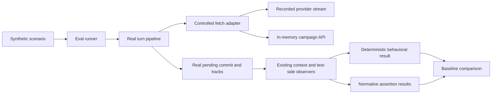

Phase 0 should extend the existing canonical-turn test seam into a **small Vitest-based evaluation harness**. It does not need a new provider API, persistence system, scoring framework, or production call-ledger service.

This plan is grounded in repository commit `8e040d0bd14403b02942643c2dc6b46bffb8be2b` and the frozen architecture documents. No files were modified. Tests were not run: this checkout has no installed `node_modules`.

## A. Existing infrastructure assessment

The strongest starting point is [the base-app gate](C:/Users/Robert%20Piccirillo/Documents/dev/DMNarrativeEngine-Next/src/services/turn/__tests__/baseAppGate/runCanonicalTurn.ts). It already exercises:

`runTurn()` → real context gathering and payload construction → real provider streaming parser → pending draft → `commitPendingTurn()` → real post-turn pipeline.

Network responses are synthetic. This is a useful engine baseline, but it does **not** execute the actual backend persistence or NLP services.

### Reuse decisions

| Existing utility | Classification | Phase 0 decision and reason |
|---|---|---|
| `baseAppGate/runCanonicalTurn.ts` | **Wrap with an adapter** | Preserve the existing runner and baseline. Follow its orchestration sequence in a parameterized eval runner; reuse its exported fixture factories and recorder. Its hard-coded single-turn state prevents direct reuse for all scenarios. |
| `baseAppGate/fixture.ts` | **Reuse directly** | Use its synthetic context, settings, history, provider, chapter, and register factories as defaults. Override explicitly per scenario. Comments describe some collections as empty although the actual factories supply an archive entry and chapter; use the implementation. |
| `baseAppGate/deterministicSeams.ts` seeded RNG | **Reuse directly** | The exported seeded `Math.random` seam already controls engine rolls and incidental randomness. Restore it in `finally`. |
| Deterministic clock | **Wrap with an adapter** | Use a fixed virtual epoch in the new harness. Existing gate behavior remains untouched. Remove operational timestamps from new deterministic artifacts. |
| Immediate deterministic timers and `drainTimers()` | **Do not reuse for the new runner** | They discard delays and immediately fire request deadlines, gather timeouts, debounces, and retry timers. That is insufficient for a broader streaming and multi-turn suite. Use controlled Vitest fake timers. |
| `installDeterministicUid({ uid })` | **Do not reuse as an ID guarantee** | The runner passes a temporary object containing the imported function. Replacing that property does not replace other modules’ imports. Existing baseline IDs also reflect the real clock/RNG-based generator. Pin runtime randomness and normalize generated identities in the result adapter. |
| `installMockFetch()` | **Extend narrowly through an eval adapter** | Keep its route-table concept. The new adapter must record responses, retain synthetic writes, handle multiple turns, and treat unmatched requests as harness errors. Its current unmatched-404 response can be swallowed by production fallback code. |
| `runCanonicalTurn.ts` SSE helper | **Extract/generalize conceptually into the eval adapter** | The current implementation enqueues the complete stream in one byte chunk, despite comments suggesting otherwise. New replay must support separately delivered chunks and split SSE records. Leave the original helper unchanged. |
| `recorder.ts` callback wrapper and `RecordedEffect` | **Reuse directly** | Already records callback arguments without bypassing store mutations. Adapt its output into a stricter, focused eval result. |
| Recorder API/queue/lifecycle methods | **Wrap with an adapter** | These methods exist, but the canonical runner does not wire all of them into API and queue execution. Add test-side observation rather than assuming complete capture. |
| `deepNormalize()` | **Do not reuse as canonical serialization** | It neither sorts object keys nor enforces privacy. It substitutes functions and can collapse an unserializable object into a string. New artifacts need explicit projection and strict serialization. |
| `baseAppGate/baseline.json` and byte diff | **Reuse directly as a compatibility gate** | Preserve exactly. Its compact first-byte diff is useful for the old contract, but insufficient for categorized eval reports. |
| `turnContextGolden.test.ts` | **Reuse directly as a compatibility gate** | Preserve its complete payload snapshot and mocked dispatch-contract tests. Do not move its private fixtures merely to avoid a small amount of duplication. |
| `getPendingTurnSnapshot()` | **Reuse directly** | Exposes the existing captured `TurnContext`, including gathered context and payload. Read it before commit clears the pending snapshot. No new production context hook is needed. |
| `getCachedSwipePayload()` | **Reuse directly** | Capture the actual cached provider messages. Missing payload after an apparently successful turn is an error; do not silently replace it with `[]`. |
| `traceCollector.ts` | **Reuse directly** | Enable existing debug tracing in eval fixtures. Capture its source, inclusion, reason, position, classification, and token fields. Do not invent target authority classifications that the runtime does not provide. |
| `utilityCallTracker.ts` | **Wrap with an adapter** | Useful purpose labels and terminal status, but it records timestamps, has bounded history, and is not a complete request-attempt ledger. Observe starts and settlements without changing behavior. |
| `llmRequestQueue.ts` | **Wrap with an adapter** | Observe real acquisition and release. Local endpoints already serialize at one request per endpoint. There is no queue-wait telemetry or public queue reset; use fresh isolated workers. |
| `llmService.sendMessage()` and `llmFetch()` | **Reuse directly** | Inject replay at fetch, below request construction and stream parsing. This preserves provider formatting, streaming callbacks, tools offered, and current timeout behavior. |
| `llmCall()` | **Wrap with an adapter** | Capture auxiliary purpose labels and request attempts, including retries. Return fixed nonstreaming responses at the fetch boundary. |
| `cacheTelemetry.ts` | **Do not reuse for general token/call accounting** | It is a daily cache-specific rollup. Calls without cache hit/miss fields are ignored, so it cannot supply total calls or general usage. |
| `infrastructure/tokenizer.ts` | **Reuse directly** | Use existing `countTokens()` estimates. Label them `cl100k_base` estimates, not target-model tokenizer counts. |
| `backgroundQueue.ts` | **Wrap with an adapter** | Observe `push()` and the execution closure while preserving concurrency. Await tracked jobs. `clear()` drops pending work but does not stop active work. |
| Track registries | **Reuse directly** | Run real registered core tracks. Capture enablement and resulting effects; do not replace the track runner with a sequential fake. |
| `mergeLifecycleEntries()` / `isFactActive()` | **Reuse directly** | Already implement guarded supersession and suppression of superseded/retracted entries. Suitable for current-state baseline coverage. |
| `knowledgeScope.ts` and payload filtering | **Reuse directly** | Existing `knownBy` semantics support a bounded secrecy fixture. They are not the future epistemic model. |
| Store divergence-edit actions | **Reuse directly** | `editDivergenceFact()` changes text, marks the source manual, and schedules a dedicated divergence save. This is the current correction seam. |
| `flushAllPendingSaves()` / `cancelPendingSaves()` | **Reuse directly** | Explicitly flush writes at observation boundaries and cancel pending work during cleanup. Existing persistence tests demonstrate their use. |
| Existing provider/stage mocks | **Do not reuse as the main replay path** | Useful isolated tests, but several replace `buildPayload`, the store, or `sendMessage`. Those replacements would hide precisely the behavior Phase 0 must capture. |
| Vitest fake-timer patterns in queue and persistence tests | **Reuse directly** | Established repository convention; no additional timing library is needed. |
| Lifecycle recording-mod fixtures | **Do not reuse** | They introduce plugin machinery unrelated to this zero-mod baseline. |
| Existing Playwright uninstall helpers | **Do not reuse** | Some inspect the active campaign and local settings. The eval harness must never discover or operate on a live campaign. |

Relevant existing tests include:

- `src/services/__tests__/divergenceRegister.test.ts`
- `src/services/campaign-state/__tests__/knowledgeScope.test.ts`
- `src/services/__tests__/payloadCacheStability.test.ts`
- `src/services/__tests__/payloadBuilder.test.ts`
- `src/store/__tests__/establishedFactsPersistence.test.ts`
- `src/store/__tests__/knownBySetter.test.ts`
- `src/services/llm/__tests__/llmRequestQueue.test.ts`
- `src/services/__tests__/postTurnSealGolden.test.ts`
- `src/services/payload/contributions/__tests__/finalUserAssemblyGolden.test.ts`

These provide useful invariant examples. Their existence is not evidence that the current checkout passes them.

## B. Phase 0 technical design

Use Vitest for TypeScript loading, jsdom, isolation, assertions, and fake timers. Use a small Node script only to select modes, launch runs, and manage artifacts.



### Minimum structures

| Structure | Minimum responsibility |
|---|---|
| `EvalScenario` | Stable ID/version, synthetic fixture factory, seed, ordered turns, optional typed setup operations, response fixtures, assertion IDs. |
| `RecordedStoryResponse` | Ordered content deltas, optional reasoning/tool deltas, optional recorded usage. |
| `EvalRunManifest` | Schema and suite versions, tested source revision, fixture/lockfile hashes, scenario IDs, result-file hashes. |
| `TurnEvalResult` | Prompt, selected retrieval information, observed effects/writes, call ledger, final messages, selected state, diagnostics. |
| `SnapshotExpectationKind` | Literal distinction between `behavioral` capture and `normative` checks. |
| `LiveSmokeResult` | Environment identity, per-turn/call measurements, failures, and human observations. |

Do **not** introduce:

- A new production `StoryTransport` interface. The fetch adapter is the transport seam.
- A general `EngineEffect` hierarchy. Reuse `RecordedEffect`, supplemented by projected API writes and selected state changes.
- A generic `MetricSample` system. Direct typed fields are sufficient.
- A scenario DSL. Typed factories and ordinary functions are sufficient.

Keep all harness implementation under `src/eval/__tests__/`. The current TypeScript app configuration excludes `__tests__`, which avoids pulling Node/Vitest utilities into application compilation.

## C. Exact scenario suite

Use **five scenarios, eight total replayed turns**. All data is synthetic.

Common defaults:

- Zero mods and extension contributions.
- Fixed RNG seed `12345`.
- Existing base-app context/history factories.
- Debug tracing enabled.
- Existing Lite tier for scenarios 1–4.
- Relationship memory disabled, no utility endpoint getter, no intro generation, no deep-search request, no automatic condensation.
- Real core tracks remain registered.
- Synthetic API retains archive appends, register writes, and state writes.
- Every turn is explicitly committed before the next turn begins.

These are fixture settings, not a new production constrained-local preset.

### 1. `canonical-commit` — one turn

**Purpose:** Establish normal engine → Story → pending draft → commit behavior.

**Starting state:** Base-app fixture, including its existing inventory, history, archive entry, chapter, and engine DC configuration.

**User input:**  
“I step through the tavern door, scanning the room for trouble.”

**Recorded Story response:** Existing `FIXTURE_GM_COMPLETION`, delivered in three content deltas.

**Behavior captured:**

- Engine-adjusted input and provider messages.
- Engine context patch.
- Incremental assistant updates.
- Pending marker before commit.
- Archive append request and assigned scene ID.
- Committed messages and selected engine state.

**Normative assertions:**

- Engine DC updates match the fixed-seed fixture expectations.
- Generation alone does not append the scene to the archive.
- Commit appends exactly one scene and anchors the assistant message to its returned ID.
- Committed message no longer carries pending/swipe working markers.
- Final provider user message contains the current input and engine outcomes.
- Exactly one streaming Story request is issued for this Lite fixture.

**Behavioral-only limitations:** Snapshot existing prompt wording, history treatment, and post-turn ordering. This scenario does not certify atomic disk persistence.

**Why now:** It is the anchor for every later comparison.

### 2. `stale-holder-supersession` — one turn

**Purpose:** Exercise existing lifecycle suppression through the real prompt path.

**Starting state:**

- Fact `holder-old`: “Mira holds the Moon Key.”
- State key `item:moon-key:holder`.
- Apply real `mergeLifecycleEntries()` with `holder-new`: “Kaelen holds the Moon Key,” superseding `holder-old`.
- Persist the resulting register through the real store action and synthetic API.
- Include one older archive source describing Mira’s earlier possession.

**User input:**  
“I check who currently carries the Moon Key before leaving.”

**Recorded Story response:**  
“Kaelen checks the Moon Key at his belt. Mira gathers her cloak.”

**Behavior captured:**

- Register lifecycle metadata.
- Retrieved older-source IDs and content inclusion.
- Established-facts block.
- Archive writes and final selected register state.

**Normative assertions:**

- Old fact remains retained with superseded status and successor link.
- New fact is active.
- The current established-facts block includes the new holder and excludes the old holder.
- A replayed Story response does not reactivate the superseded register entry.

**Behavioral-only limitations:** Older narrative may still be retrieved or quoted. Snapshot its presence and current labeling; do not require global deletion of historical evidence or future authority-aware packing.

**Why now:** Existing lifecycle support makes this meaningful without a new state model.

### 3. `scoped-secret-cast-change` — two turns

**Purpose:** Measure current secret filtering and its boundaries.

**Starting state:**

- Synthetic NPCs Mira and Aldric.
- Public fact: “The east bridge is closed.”
- Mira-scoped fact: “The brass token opens the cellar,” `knownBy: ['npc:mira']`.
- Fully hidden fact: “The cellar contains the royal seal,” `knownBy: []`.
- Player-only fact: “The player recognizes the token’s maker,” `knownBy: ['player']`.
- No historical or lore copies of those secret texts.
- Mira on stage for turn 1; switch to Aldric through fixture setup before turn 2.

**Fixed turns and responses:**

1. “I ask Mira what the brass token is used for.”  
   Response: “Mira turns the token between two fingers and asks where you found it.”
2. “I ask Aldric whether the east bridge is open.”  
   Response: “Aldric shakes his head. The east bridge remains closed.”

The first response deliberately does not repeat the secret into history.

**Behavior captured:**

- Scoped block content for each cast.
- Public cached block.
- Player-only fact treatment.
- Final messages and on-stage state.

**Normative assertions:**

- Public fact is available.
- Mira-scoped fact is available with Mira on stage.
- It is absent with only Aldric on stage.
- Fully hidden fact is absent from the captured prompt.
- Scoped facts are absent from the public cached established-facts block.

**Behavioral-only limitations:** Current filtering uses “any on-stage knower,” not independent epistemic views. The inspected scoped-block implementation also excludes player-only facts through its NPC-knower predicate; capture resulting treatment without making that omission a specification.

**Why now:** This is a small test of implemented visibility rules, not future belief adoption or testimony.

### 4. `manual-correction-retention` — two turns

**Purpose:** Verify the current manual correction survives persistence and another turn.

**Starting state:**

- Fact `bridge-status`: “The north bridge is open.”
- Ordinary synthetic history and chapter.
- Between turns, invoke real `editDivergenceFact()` with “The north bridge is closed.”
- Flush pending saves.
- Rehydrate the relevant register/state fields from the synthetic API’s persisted image before turn 2.

**Fixed turns and responses:**

1. “I stop near the north bridge and inspect the road.”  
   Response: “Rain gathers in the wheel ruts beside the north bridge.”
2. “I check the north bridge’s current status before choosing a route.”  
   Response: “The north bridge is closed. A barrier blocks the approach.”

**Behavior captured:**

- Edit operation.
- Dedicated divergence PUT.
- Register before and after the persistence round-trip.
- Turn-2 current-facts block.
- Final register and accepted messages.

**Normative assertions:**

- Corrected entry retains its ID and has manual source.
- Dedicated divergence persistence contains the corrected text.
- Correction survives the controlled persistence round-trip and subsequent commit.
- Current established-facts block contains the correction rather than the original text.

**Behavioral-only limitations:** This is a legacy manual edit. It does not provide immutable correction history, dependency invalidation, rewind, or transactional correction semantics.

**Why now:** It establishes the behavior later correction work must compare against.

### 5. `call-ledger-pro` — two turns

**Purpose:** Capture an existing auxiliary-call pattern and prove accounting distinguishes purpose from HTTP traffic.

**Starting state:**

- Minimal zero-NPC fixture.
- Existing Pro tier.
- Story and auxiliary roles resolve to the same synthetic local endpoint.
- No utility endpoint getter.
- No sealed chapters, relationship memory, or bookkeeping trigger.
- Bookkeeping counter increments normally.

**Fixed turns and responses:**

1. “I inspect the courtyard gate before approaching the guardhouse.”  
   Story: “The courtyard gate stands open. Rain darkens the guardhouse roof.”
2. “I wait beside the courtyard gate and watch the guardhouse.”  
   Story: “A shutter opens above the guardhouse door, then closes again.”

For each turn, provide a fixed nonstreaming Director response:

“WRITER BRIEF  
Render the stated action and preserve the established location.”

**Behavior captured:**

- Director and Story requests separately.
- Shared endpoint identity.
- Logical invocation count and actual HTTP attempt count.
- Purpose labels, streaming flags, terminal status, and resulting prompt changes.

**Normative assertions:**

- Exactly one streaming Story request per successful turn.
- Every dispatched provider request belongs to a ledger entry.
- Retries, if introduced, count as additional attempts.
- No call is unclassified.
- No undeclared background or post-turn request escapes observation.

**Behavioral-only limitation:** The additional blocking Director call is current behavior. Snapshot the complete two-purpose sequence; do not enforce the future universal one-call path in Phase 0.

**Why now:** It prevents a misleading “one call” baseline that only counts Story requests.

## D. Determinism strategy

The contract is **byte-stable result files for repeated runs of the same source and fixture versions in the declared harness environment**.

| Source | Treatment |
|---|---|
| `Date.now()` and `new Date()` | Fixed virtual epoch. Advance only through the harness clock. Omit operational timestamps from serialized results. |
| Engine randomness | Install existing seeded RNG before constructing runtime fixtures. Never consume it in observers. |
| Generated message/swipe/call IDs | Preserve runtime generation; map generated IDs consistently to scenario-local aliases during projection. Preserve fixture/source IDs unchanged. |
| UUIDs and provider request IDs | No required UUID source was identified in this turn seam. Normalize incidental IDs if encountered; reject unknown identity-bearing fields rather than leaking them. |
| Module-level turn counter | Normalize to scenario/turn ordinal. Do not add production reset APIs. |
| Director/stance/role/queue singleton state | Fresh Vitest worker per scenario; turns within that scenario share the intended state. |
| Timers | Fake only application clock/timer APIs. Advance zero-delay work while requests progress, then explicitly flush debounced saves. Never indiscriminately run all future deadline timers. |
| Async completion ordering | Deterministic response delivery; track every started job and request. Preserve causal event order. Do not sort competing writes to conceal races. |
| Background work | Observe real execution, await tracked work, require quiescence, then clean up. Repeated timer drains alone are insufficient. |
| Performance timers | Exclude from deterministic results. Live observations use real monotonic time. |
| Object keys | Recursively sort keys using code-point ordering. |
| Arrays | Preserve prompt order, retrieval rank, stream order, write order, and message order. Sort only explicitly unordered collections. |
| Maps/Sets | Convert according to declared field semantics; never apply a blanket sort. |
| Filesystem enumeration | Explicit scenario list; sort artifact paths before hashing. |
| Absolute paths and temporary directories | Omit. Artifacts contain repository-relative logical names only. |
| Endpoint URLs | Store fixture endpoint aliases; discard origin, credentials, query secrets, and local filesystem details. |
| Environment/settings | Explicit synthetic settings. Do not load live settings, localStorage, campaign directories, or vault contents. |
| Locale/timezone | Launch eval workers with UTC and a declared locale. Use ASCII fixture identifiers and explicit ordering; production uses some `localeCompare()` calls. |
| Line endings | Canonical JSON formatting uses LF. Keep fixture text deliberately LF-based. Do not silently rewrite actual generated prompt content during projection. |
| Encoding/dependencies | UTF-8, pinned lockfile, named Node/Vitest/tokenizer versions. |
| Errors/logs | Capture bounded structured diagnostics. Omit stacks, paths, and runtime duration text. Unknown unsafe diagnostics fail artifact validation. |

Canonical output: sorted object keys, two-space JSON indentation, UTF-8, LF, one trailing newline. Reject unsupported values and nonfinite numbers.

Use `try/finally` for every installed observer, timer seam, random seam, and store reset. Cleanup must await active work before restoring fetch.

## E. Snapshot versus normative-assertion design

Keep these separate in storage and reporting.

**Behavioral snapshots**

- Checked-in JSON under `eval/baselines/v0/`.
- Describe current prompts, retrieval, effects, calls, messages, and selected state.
- Differences produce `REVIEW_REQUIRED`.
- Comparison does not silently update them.
- A difference alone does not fail a normative test.

**Normative assertions**

- Ordinary TypeScript/Vitest assertions with stable IDs.
- Located in `src/eval/__tests__/assertions.ts`.
- Grouped as state, stale suppression, visibility, correction, prompt, and calls.
- Report requirement, pass/fail status, and concise failure detail separately.
- A violation fails the eval run.

Example report:

```text
canonical-commit
  NORMATIVE PASS  state.commit-anchor
  NORMATIVE PASS  prompt.current-input
  BEHAVIORAL REVIEW_REQUIRED  prompt.messages[1].content

call-ledger-pro
  NORMATIVE FAIL  calls.every-attempt-accounted
  BEHAVIORAL CHANGED  calls.totalAttempts: 4 -> 5
```

No expected-failure assertions or assertion DSL are needed.

Future phases add new assertions against their implemented contracts. They must not turn historical JSON into normative specifications. Updating a behavioral baseline cannot clear a normative failure.

The existing base-app gate retains its stricter historical byte-equality policy; Phase 0 does not weaken it.

## F. Recorded Story replay design

Intercept `fetch()` beneath [the existing provider service](C:/Users/Robert%20Piccirillo/Documents/dev/DMNarrativeEngine-Next/src/services/llm/llmService.ts), including the `/llm/proxy` envelope.

For each turn:

1. Construct fresh `TurnState` from the current synthetic store.
2. Use `getMessages: () => useAppStore.getState().messages`; avoid the original runner’s separate history buffer.
3. Install pass-through call observers before importing the runtime.
4. Match provider requests against the scenario’s declared purpose/occurrence.
5. For Story, return OpenAI-compatible SSE using separate stream deliveries.
6. For Director, return a normal nonstreaming completion containing the recorded brief.
7. Run real `runTurn()`.
8. Read `getPendingTurnSnapshot()` before commit; copy payload and relevant `turnContext.gathered` fields.
9. Capture pending state.
10. Invoke real `commitPendingTurn()`.
11. Flush saves and await tracked jobs/requests until idle.
12. Project the result and evaluate assertions.

The synthetic campaign API must be **stateful**:

- Archive append allocates stable sequential scene IDs.
- Archive/index/chapter/timeline reads reflect fixture state and recorded writes.
- Divergence PUT retains the written register.
- State PUT retains the requested state.
- Scene fetches resolve only declared synthetic source IDs.
- Unknown routes or unexpected model requests are harness errors, even if production catches their exceptions.

Preserve real production methods. Test-side wrappers should observe `sendMessage`, `llmCall`, queue acquisition/release, and background execution. Async-local correlation can associate overlapping calls with their purpose without matching on prompt text.

Do not replay through mocked `sendMessage()` callbacks; that would bypass provider formatting and parsing.

## G. Captured metrics and artifacts

### Deterministic turn result

| Category | Capture |
|---|---|
| Prompt | Complete ordered provider messages, including roles, tool metadata, and cache-control fields. |
| Request configuration | Model alias, streaming flag, sampling/output settings, offered tools. Strip proxy/auth envelope. |
| Prompt trace | Existing trace entries and inclusion decisions. Avoid duplicating complete debug payloads inside final messages. |
| Retrieval | Semantic candidate IDs, fetched recall IDs, relevant lore/rule IDs, elevated IDs, slotted IDs where populated; preserve rank. |
| Effects | Relevant callback effects, selected store-field changes, queue lifecycle, archive/post-turn effects. |
| Writes | Method, logical route, and focused body for state, register, archive, and related writes. |
| Calls | Purpose, logical invocation ordinal, actual request attempts, phase, streaming flag, terminal status. |
| Tokens | Existing section estimates, request-text estimate, recorded provider usage where supplied. Clearly distinguish their origins. |
| Messages | Final content, role, normalized identity, scene anchor, and meaningful pending/retry state. |
| State | Scenario-selected fields: engine DCs, lifecycle register entries, correction text/source, visibility cast, selected inventory/location fields. |
| Diagnostics | Structured warnings/errors and unmatched-request information. |

Do not dump the whole Zustand store, callbacks, providers, settings, or full saved campaign payload repeatedly.

Candidate IDs, selected/fetched IDs, and prompt inclusion are distinct. Existing traces do not expose every final source decision structurally. Capture what the gathered context exposes and state any remaining ambiguity; do not infer reliable source IDs by parsing prose.

### Artifacts

```text
eval/baselines/v0/manifest.json
eval/baselines/v0/canonical-commit.json
eval/baselines/v0/stale-holder-supersession.json
eval/baselines/v0/scoped-secret-cast-change.json
eval/baselines/v0/manual-correction-retention.json
eval/baselines/v0/call-ledger-pro.json

.eval-output/current/...
.eval-output/report.json
.eval-output/report.md
.eval-output/live/...
```

Manifest provenance should identify the tested source commit, seed, scenario versions, fixture hashes, lockfile hash, and artifact hashes. No creation timestamp or random run ID is needed.

Record the harness implementation commit **before** the baseline-artifact commit, avoiding a self-referential commit hash.

### Focused comparison

Report differences under:

- `prompt`
- `retrieval`
- `effects-and-writes`
- `calls-and-tokens`
- `messages`
- `state`
- `diagnostics`

For each, show a path and concise old/new values. Use Vitest’s existing assertion diffs for normative failures. A small structural JSON comparison is sufficient for behavioral output; no dashboard is needed.

Default comparison exits successfully when only behavioral review is required, while displaying that status prominently. Normative violations, invalid artifacts, and incomplete runs exit unsuccessfully.

### Privacy

Commit only synthetic fixtures, replay responses, deterministic baselines, manifests, and documentation.

Ignore `.eval-output/`, including live transcripts and performance results. Never load live campaign data during recording. Project fields before writing; do not rely on broad redaction afterward.

Reject credential/header fields, absolute paths, real endpoint identities, and unexpected fixture content in committable artifacts. Keep local provider configuration outside committed output.

## H. Live-smoke design

Use a **special eval command backed by an opt-in Vitest configuration**, not a normal unit-test suite or a new browser application.

Run the same real frontend turn/commit path and synthetic campaign API with:

- Real timers and monotonic measurements.
- Actual configured local Story endpoint/model.
- Real provider request building and stream parsing.
- No replayed Story responses.
- Explicit zero-mod fixture settings and declared endpoint-role mappings.

This measures frontend orchestration plus local inference. It does not measure backend disk commits, vector search, or deferred server NLP. In particular, `server/services/nlpPipeline.js` can issue separate requests when utility configuration and detected NPCs are present; this synthetic API does not execute it. Record that coverage boundary in the smoke manifest.

### Fixed seven-turn script

Use one synthetic courtyard campaign:

1. “I enter the courtyard and look toward the guardhouse.”
2. “I ask Mira whether the east bridge is open.”
3. “I inspect the brass token without showing it to Aldric.”
4. “I ask Aldric which road reaches the north bridge.”
5. Apply the same manual bridge correction used by the replay fixture, then: “I check the north bridge’s current status.”
6. “I ask Mira who currently carries the Moon Key.”
7. “I remain beside the courtyard gate and watch what happens next.”

Commit each response. Do not adapt questions based on generated text. Generated responses remain live observations, not correctness or prose-quality scores.

### Required environment manifest before sampling

Require:

- Exact model identifier and quantization.
- Inference server/version.
- Context window and output limit.
- Sampling settings.
- CPU, RAM, GPU/VRAM where present.
- CPU-only or named offload configuration, including layer count where applicable.
- Thread/batch settings where available.
- Endpoint-role mapping and fixture settings.
- Cold/warm model status.
- Source, harness, and script identities.

No target model, quantization, or hardware configuration was established by this repository inspection. Do not invent them. The smoke command should reject missing required identity fields before issuing requests.

### Measurements

For every provider attempt:

- Queue wait: acquisition requested → slot granted.
- TTFT: dispatch → first parsed nonempty narrative delta.
- Also record time to first reasoning delta separately when present.
- Generation latency: dispatch → completion.
- Logical-call latency: invocation → terminal outcome.
- Turn latency: turn start → generated draft, and separately → committed synthetic state.
- Input/output usage when returned; otherwise `null`.
- Existing tokenizer estimates in separate fields.
- Purpose, attempt count, errors, and unexpected automatic calls.

Observe streaming without buffering it before the real consumer. Instrument the existing callbacks for parsed first-token timing.

Track post-turn work until idle or a declared bounded timeout; report unfinished work explicitly. Predeclare a per-call ceiling and a total smoke ceiling, with no automatic continuation beyond seven turns.

Store performance values and live text only under ignored local output. Require concise human notes on coherence, correction retention, secret handling, repetition, and agency. An unfilled observation field means the smoke report is incomplete.

There are no automatic latency thresholds, statistical claims, or LLM judges.

## I. Proposed file-by-file changes

All paths below are proposed; none were created.

| File | Action | Responsibility / important interfaces | Production impact |
|---|---|---|---|
| `src/eval/__tests__/support/types.ts` | Create | Small scenario, response, manifest, result, assertion-result, and smoke types. | None. |
| `src/eval/__tests__/support/runScenario.ts` | Create | `runScenario()`, fresh state construction, real callbacks, snapshot capture, commit, cleanup, bounded quiescence. | None. |
| `src/eval/__tests__/support/replayIO.ts` | Create | Stateful synthetic API, strict route matching, recorded SSE/nonstreaming responses, write journal. | None. |
| `src/eval/__tests__/support/observe.ts` | Create | Pass-through call, request-attempt, queue, background-job, and selected store-change observation. | None. |
| `src/eval/__tests__/support/artifacts.ts` | Create | Projection, ID aliases, privacy validation, canonical serialization, hashes, categorized comparison/reporting. | None. |
| `src/eval/__tests__/fixtures/scenarios.ts` | Create | Five explicit factories, eight turns, synthetic source records, setup operations, fixed responses. Reuse base-app factories. | None. |
| `src/eval/__tests__/assertions.ts` | Create | Named ordinary assertions for six required categories. | None. |
| `src/eval/__tests__/replay.test.ts` | Create | Runs selected scenario, evaluates normative checks, emits candidate result and behavioral report. | None. |
| `src/eval/__tests__/harness.test.ts` | Create | Tests determinism, serializer, strict I/O, streaming boundaries, accounting, cleanup, and focused comparison. | None. |
| `src/eval/__tests__/liveSmoke.smoke.ts` | Create | Seven-turn opt-in live run and performance capture; filename excluded from ordinary test matching. | None. |
| `src/eval/__tests__/fixtures/liveSmoke.ts` | Create | Fixed seven inputs and synthetic live fixture; environment-manifest validation. | None. |
| `vitest.eval.config.ts` | Create | Derive from existing config; retain jsdom/setup/version definition; include only replay entry; isolated sequential workers. | None to ordinary tests. |
| `vitest.eval-live.config.ts` | Create | Include only `.smoke.ts`; real timers, explicit opt-in, bounded timeouts. | None to ordinary tests. |
| `scripts/run-eval.mjs` | Create | `compare`, `record`, `verify-determinism`, and `live`; launch fresh workers, check prerequisites, manage paths/manifests. | Developer tooling only. |
| `eval/baselines/v0/manifest.json` | Create | Version-pinned baseline provenance and hashes. | None. |
| Five `eval/baselines/v0/<scenario>.json` files | Create | Behavioral results for the exact scenario IDs above. | None. |
| `docs/eval/phase-0.md` | Create | Commands, fixture scope, measurement definitions, review policy, limitations, smoke procedure. | None. |
| `package.json` | Modify | Add eval commands while preserving existing scripts. No new dependency required. | Developer tooling only. |
| `.gitignore` | Modify | Ignore `.eval-output/` and local smoke configuration. | None. |

**No moves are recommended.** Leave the base-app helpers and baseline where they are. A small amount of scenario-runner composition is cheaper than relocating a compatibility-sensitive gate.

Do not modify `llmRequestQueue.ts`, `traceCollector.ts`, provider APIs, store slices, orchestration, or either frozen architecture document.

`AGENTS.md` requests a graph refresh after import/configuration changes, but `scripts/patch-graph-imports.mjs` is absent in this checkout. Report that explicitly during implementation; do not recreate graph tooling as part of Phase 0.

## J. Implementation sequence

1. **Establish the pre-change gate.** Install locked dependencies, run the full suite, base-app gate, and prompt golden. Record failures before editing. Review the small result schema and smoke script.
2. **Add strict artifact utilities.** Implement projection, privacy validation, canonical serialization, and focused comparison using tiny test objects.
3. **Add the replay I/O adapter.** Test stateful writes, source reads, strict unmatched routes, split SSE delivery, and nonstreaming responses.
4. **Add observations and scenario execution.** Run one canonical turn through the real pipeline. Prove pending/commit separation, complete accounting, quiescence, and cleanup.
5. **Add the five fixtures and six assertion categories.** Keep future architectural requirements out of current-runtime assertions.
6. **Add commands and determinism verification.** Run each scenario in isolation, compare two fresh runs, and compare repeated runs within one worker.
7. **Capture a candidate baseline.** Review categorized artifacts and known limitations. Preserve old golden files unchanged.
8. **Add and validate the live-smoke mode.** Verify timing calculations using controlled delayed streams, then record the named local environment and execute seven actual turns.
9. **Pin the baseline and document the handoff.** Record source/harness identities and artifact hashes before Phase 1 begins. Re-run the relevant existing gates and full suite.

Each step should leave ordinary tests green where practical. Do not capture an approved baseline from an incomplete or failing harness.

## K. Test plan

### Harness correctness

- Multi-chunk stream produces incremental callbacks and the expected final text.
- Splitting an SSE record or UTF-8 sequence across deliveries preserves parsed output.
- Recorded nonstreaming Director response follows the real parser path.
- Unknown API route and extra model request fail despite production exception handling.
- Stateful archive reads reflect appends.
- Correction writes survive the controlled persistence round-trip.
- Background jobs and pending saves are settled before result capture.
- Exception paths restore globals and leave no active requests.
- Call accounting distinguishes invocations, attempts, and non-model API traffic.
- Failed and retried requests remain visible.

### Determinism and artifact safety

- Two fresh-process runs produce identical result bytes and hashes.
- Two sequential runs do not inherit store, cache, counter, or queue contamination.
- Object insertion-order variation does not change bytes.
- Retrieval rank and write-order changes do change bytes.
- Fixture/source IDs survive normalization.
- Generated-ID references remain consistent.
- Credentials, absolute paths, timestamps, stacks, unsupported values, and live configuration cannot enter committable output.

### Focused-diff proof

Mutate captured test results, without changing production:

1. Prompt text.
2. Retrieved source ID.
3. Model-call attempt count.
4. State write value.

Each must produce a change in the corresponding report category. Also prove that a behavioral mismatch reports review while a normative violation fails.

### Existing coverage preservation

Keep unchanged:

- Base-app test, runner, fixture, and baseline.
- `turnContextGolden.test.ts` and its snapshot.
- Final-user assembly golden.
- Post-turn seal golden.
- Existing queue, visibility, lifecycle, and persistence tests.

No baseline refresh should be necessary because production behavior is unchanged.

### Commands at completion

Preserve:

```text
npm test
npm run test:run
npm run test:base-app-gate
npm run test:coverage
```

Add:

```text
npm run eval
npm run eval:record
npm run eval:determinism
npm run eval:live -- --config <ignored-local-config>
```

Semantics:

- `eval`: replay offline, run assertions, compare with pinned baseline.
- `eval:record`: write candidates under ignored output; never overwrite the pinned baseline automatically.
- `eval:determinism`: compare independent runs.
- `eval:live`: explicit local inference only; excluded from CI and normal unit tests.

## L. Acceptance-criteria traceability

| Roadmap criterion | Implementation | Test / evidence |
|---|---|---|
| One offline command | `eval` script, replay config, strict synthetic fetch | Clean-checkout run with no server/model; any undeclared fetch is an error. |
| Byte-stable reruns | Fixed seed/clock, isolated workers, strict projection/serialization | Two independent runs with identical file hashes; in-worker contamination test. |
| Focused prompt/retrieval/call/state diffs | Categorized comparison | Four deliberate artifact mutations produce the expected category and path. |
| Tracked-state assertion | Canonical engine update and commit anchor | Fixed-seed state checks plus precommit/postcommit assertions. |
| Stale-suppression assertion | Lifecycle scenario | Superseded record retained but excluded from current established facts. |
| Knowledge-visibility assertion | Cast-change scenario | Positive knower inclusion, nonknower exclusion, fully hidden exclusion. |
| Correction assertion | Manual-edit scenario | Dedicated write, persistence round-trip, subsequent prompt/state retention. |
| Prompt assertion | Canonical scenario | Current input and engine outcomes reach the final provider user message. |
| Model-call assertion | Canonical and Pro ledger scenarios | One Story dispatch per turn; every actual attempt classified and accounted. |
| Behavioral/normative distinction | Separate files/results and statuses | Behavioral-only change requests review; normative violation fails. |
| Bounded live smoke | Seven-turn `.smoke.ts` suite | Named model/hardware manifest, per-call timings, failures, call totals, human notes. |
| Baseline pinned before Phase 1 | Manifest and five result files | Source/harness revision, fixture/lock hashes, artifact hashes, clean diff review. |

All criteria can be addressed without production behavior changes. Two qualifications must remain explicit:

- Phase 0 assertions cover **existing legacy seams**, not unimplemented transactional or epistemic guarantees.
- Actual live-smoke acceptance requires the operator’s model/quantization/hardware identity and completed run; implementation alone does not satisfy it.

## M. Risks and mitigations

| Risk | Mitigation |
|---|---|
| Existing gate appears more comprehensive than its actual observation | Capture fetch responses/writes and pending `TurnContext`; explicitly wire queue and call observation. |
| Immediate timers produce false timeouts or hangs | Controlled virtual time and bounded quiescence; retain original gate timer behavior separately. |
| Normalization hides regressions | Normalize only declared incidental identity/time fields. Preserve content, ranks, write ordering, and meaningful values. |
| Multi-turn state becomes stale | Construct every turn from the current store and use live message getters. |
| Unknown requests disappear into graceful fallbacks | Record adapter violations independently and fail after execution. |
| Detached post-turn work escapes capture | Track starts, promises, and requests; require idle completion. |
| Auxiliary calls are undercounted | Observe both provider entry points and actual HTTP attempts. |
| Historical defects become requirements | Separate behavioral captures from named correctness assertions. |
| Live run is mistaken for full application E2E | Declare synthetic API scope and excluded server NLP/disk behavior. |
| Live data or credentials enter artifacts | Synthetic fixtures only, allowlisted projection, ignored live outputs, artifact validation. |
| Old goldens drift during extraction | Leave their files and behavior unchanged; use adapters. |
| Baseline claims exceed available evidence | Record unrun tests and incomplete smoke explicitly; do not mark Phase 0 complete prematurely. |

## N. Explicit non-scope

Reject the following for Phase 0:

- 50–100-turn or adaptive campaign runners.
- LLM-as-judge or automated prose scoring.
- Web dashboard.
- Generic scoring/benchmark framework.
- Scenario DSL or custom assertion language.
- SQLite evaluation or persistence migration.
- Sparse epistemic claims, testimony, false-belief machinery, or per-character inference.
- Future retrieval rankings, alias campaigns, or large-corpus evaluation.
- Generalized multi-model benchmarking.
- Automatic performance thresholds or statistical significance claims.
- Production scheduler/call-ledger redesign.
- New constrained-local production policy.
- Exhaustive crash/swipe/rewind coverage.
- Real campaign import or automatic recording from user campaigns.

Leave available only small extension points: versioned scenario factories, typed result categories, assertion functions, the transport adapter, and the reusable fixed smoke script.

## O. Recommended commit structure

Suggested commits, **not executed**:

1. `test(eval): add strict artifact serialization and comparison`
2. `test(eval): add recorded I/O and real-turn scenario runner`
3. `test(eval): add five baseline scenarios and normative checks`
4. `chore(eval): add offline commands and determinism verification`
5. `test(eval): add bounded opt-in local-model smoke`
6. `test(eval): pin reviewed Phase 0 baseline and document results`

The final baseline commit should reference the preceding tested harness/source revision. Keep live credentials, transcripts, and performance files out of commits.

## P. Implementation-agent handoff

1. Read `AI_CODEBASE_MAP.md`, then frozen architecture documents 002 and 003.
2. Establish existing test status before edits; dependencies are currently absent.
3. Preserve the base-app gate and all existing golden artifacts unchanged.
4. Build the test-only runner around real orchestration, pending commit, store actions, provider parsing, and tracks.
5. Reuse exported fixture factories, recorder, lifecycle helpers, tokenizer, snapshot getters, and save-flush controls.
6. Implement exactly the five replay scenarios above, with separate behavioral results and normative checks.
7. Prove strict offline execution, complete call accounting, cleanup, privacy, focused diffs, and byte stability.
8. Capture and review deterministic candidates; never auto-accept them.
9. Record the actual local environment before running the fixed seven-turn smoke; keep performance/live output separate.
10. Pin reviewed artifacts before Phase 1. Report the absent graph-refresh script and any failing pre-existing gates. Do not expand scope or modify the frozen architecture documents.